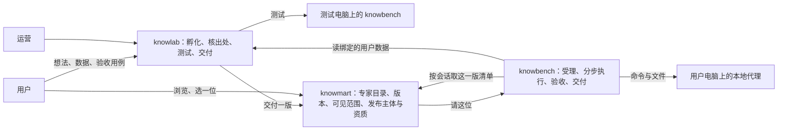

# 专家市场：架构对比与借鉴

更新日期：2026-10-18（按 2026-10-16 至 10-18 的决定整篇重写；2026-10-14 的旧版在 Git 历史里）。比较对象：腾讯 WorkBuddy 开放平台（入驻、类目与证照、专家包）、京东（前台界面）、闲鱼与淘宝上的知识与咨询服务（约定与履约机制）。

本文以已定的设计为基础：[0026 knowlab](dev-investment-agent/tree-build/SDD/modules/0026-knowlab.md)（孵化与合规）、[0027 第一条通路](dev-investment-agent/tree-build/SDD/modules/0027-knowbot-first-path.md)（交付、请、测试）、[0032 knowmart 前台](dev-investment-agent/tree-build/SDD/modules/0032-knowmart-storefront.md)（目录与可见性）。[0018 骨架](dev-investment-agent/tree-build/SDD/modules/0018-advisor-market.md)里作者另有账号体系、专家自带云上知识库、平台自营作者等内容已被这几份取代。竞品只用公开资料，下文的「架构」是可观察业务机制的抽象，不是对其内部实现的断言。整体产品比较另见[竞品比较分析](竞品比较分析.md)。

## 一、主要结论

| 参照对象 | 借鉴什么 | 我们怎么用 |
| --- | --- | --- |
| WorkBuddy 开放平台 | 开发者分个人与非个人主体，按服务类目审证照；专家包有标识、版本、依赖；发布要测试、审核 | knowmart 的发布主体、类目、资质照此建（骨架已实现，公开关着）；版本只插不改；上架前必经 knowlab 测试 |
| 京东 | 前台：类目导航、筛选条、商品详情（规格选择、参数、评价）、店铺 | knowmart 首页与详情页照此做（0032 已实现）；店铺页留给以后的持证发布主体 |
| 闲鱼 | 非标准需求先约定再履约，留争议处理依据 | 受理前说清范围（受理关口、开步前提问），委托固定版本与输入，过程留证 |
| 淘宝知识与咨询服务 | 服务写成可选择的商品与承诺 | 专家详情页写清能做什么、需要什么数据、交回什么；收费以后再说 |

**一句话：** 我们的市场是「可重复提供专业服务的目录」，不是卖文件、卖课的商店。每次请一位专家，都要能确定用哪一版方法与数据、适合什么问题、交回什么、失败怎么办。

## 二、我们在提供什么

都叫专家（2026-10-18 定，取代 10-16 的「分身」）；英文 knowbot。

| 对象 | 含义 | 现在 |
| --- | --- | --- |
| 作者 | 专家的方法与数据出自谁 | 用户本人（在 knowlab 提想法、传数据） |
| 发布主体 | 对请专家的人负责的一方：个人或非个人，都要实名；按类目持证 | 只有数据结构（knowmart `publisher`、`publisher_license`），不开放入驻 |
| 专家 | 长期身份：名字、一句话介绍、类目 | knowmart `knowbot` |
| 专家版本 | 一次交付的清单：方法包（分步、交底、验收）+ 外层（名字、版本、运行方、绑定的数据、规则出处）；只插不改 | knowmart `knowbot_version`，数据库触发器兜底 |
| 可见范围 | 自用 / 公开，后台属性，前端不贴标签 | 一律自用；公开开关默认关 |
| 委托 | 某次实际执行，钉住某一版 | knowbench 委托与步骤记账 |
| 交付记录 | 这次交回了什么、怎么验的 | knowbench 的交回物、验收记录、计算记录、项目文件 |

## 三、竞品机制比较

### 3.1 WorkBuddy 开放平台：主体、类目、证照

- **入驻与认证**：个人主体凭大陆身份证实名；非个人主体凭营业执照，加法人或管理员实名（[入驻指南](https://open.workbuddy.cn/docs/onboarding)）。
- **按类目审证照**：非个人主体每个服务类目各有所需证照。金融类：证券 / 期货投资咨询要《经营证券期货业务许可证》；公募基金要证券期货业务许可证或基金相关资格；私募基金要备案证明，只能展示、介绍、咨询；银行、信托要《金融许可证》（[服务类目·非个人主体](https://open.workbuddy.cn/docs/service-categories-enterprise)）。个人主体能选的类目里没有金融（[服务类目·个人主体](https://open.workbuddy.cn/docs/service-categories-individual)）。
- **发布流程**：注册入驻 → 资质认证 → 创建业务 → 配置能力 → 测试环境调试 → 提交平台审核 → 发布（[开放平台概述](https://open.workbuddy.cn/docs)）。
- **专家包**：有标识、版本、作者、代理定义、市场展示信息，可声明依赖（[专家包说明](https://open.workbuddy.cn/docs/expert)）；连接器写明最低客户端版本与认证方式（[连接器说明](https://open.workbuddy.cn/docs/connector)）。
- **运营数据**：召唤次数按实际次数计、不去重，是使用量口径，不等于完成任务（[运营数据说明](https://open.workbuddy.cn/en/docs/operations-data)）。

**对我们：** 主体与证照框架照搬（所有者 2026-10-18「就根据腾讯的这个框架去建knowmart」）。推论有二：个人用户的投资类专家只能自用；我们自己以普通用户做的「财务分析与预测」在拿到资格前也只能自用。照搬框架不等于照搬合规：腾讯自有平台层证照，我们开放交易时要自己办；WorkBuddy 不参与写专家的方法，我们的「辅助孵化」可能被看成共同作者——这两点在律师问题里（0026 第五节第 6、8 问）。

**待核实：** 收费、分成、独立专业验收、争议与退款的具体机制，本文不判定为竞品缺失，也不编比例。

### 3.2 京东：前台怎么摆

商家开店、平台审资质；商品标准化。首页与搜索结果页有类目导航与一条筛选条（品牌、价格等），选中的条件排成可去掉的小标签；商品详情头部是主图、标题、规格选择、主按钮，下面分页签（商品介绍、规格参数、评价）；店铺页集中一个商家的商品。

**对我们（0032）：** 页头横排一级类目、左侧可折叠的二级类目（菜单与筛选的交互另借鉴 tpl 的 Vue 版管理端）、卡片上方筛选条（数据、更新时间、排序）、已选条件与重置、分页；详情页头部有版本选择（像选规格）和「请这位」，页签是能做什么、需要的数据、交回什么、版本记录，公开专家多一个发布主体。店铺页等有持证发布主体再做。

### 3.3 闲鱼：先约定，再履约

官方协议覆盖发布、交易、交付、评价和争议调处，要求双方事先确认交付事项（[闲鱼社区用户服务协议](https://terms.alicdn.com/legal-agreement/terms/suit_bu1_other/suit_bu1_other201708081618_51146.html)）；验货宝在特定实物品类引入第三方查验，供给与检查分开（[验货宝买方协议](https://terms.alicdn.com/legal-agreement/terms/product/20221213134628952/20221213134628952.html)）。

**对我们：** 用户说「预测这个公司」时，先把对象、数据、期间、交付形式说定，再开工；明显不归这位专家的问题先停下问（受理关口，待办账 130）；改了目标就是新的约定。作者给测试用例和期望值，但通过与否由平台按用例检查，不由作者自己说了算（0027 §3.4）。个人对个人、先聊再成交的形态我们不用：个人做的投资类专家不能公开。

### 3.4 淘宝知识与咨询服务：服务写成承诺

卖家协议明确平台与卖家的经营关系和交易信用要求（[淘宝网卖家服务协议](https://terms.alicdn.com/legal-agreement/terms/suit_bu1_taobao/suit_bu1_taobao201908081502_44434.html)）。知识服务大致有资料或课程、咨询、定制成果、持续服务几类（本文的分析分类，不是淘宝官方类目）。

**对我们：** 我们更接近「可重复执行的定制成果」。作者传了多少资料、方法写了多长，都不足以说明用户该请它；用户要看到它能解决哪些问题、要什么输入、交回什么。

### 3.5 横向对照

| 维度 | WorkBuddy | 京东 | 闲鱼 | 淘宝知识服务 | 我们 |
| --- | --- | --- | --- | --- | --- |
| 供给 | 个人 / 非个人开发者，按类目审证照 | 商家开店 | 个人 | 店铺 | 用户自用；公开只对持证非个人主体 |
| 选用依据 | 能力介绍、分类、示例 | 类目、筛选、详情、评价 | 描述与沟通 | 商品说明与承诺 | 能做什么、需要的数据、交回什么、版本 |
| 交付 | 在代理环境调用 | 实物或服务 | 按约定 | 因商品而异 | 工作台分步执行，交回可核验的结果 |
| 质量机制 | 审核；专业验收细节待核实 | 平台规则与评价 | 证据与调处 | 经营责任与信用 | 先测后用 + 每步程序验收 + 数由平台算 |
| 版本 | 专家包显式版本 | — | — | — | 清单只插不改，委托钉住版本 |
| 商业化 | 未核实 | 交易 | 交易 | 交易 | 先履约，拿到资格后再定权益与结算 |

## 四、我们的架构分工



knowfeed、knowbase 是我们自己的数据平台，只用于工程测试，结果不交给用户；用户的专家不读它们（0026 总原则、待办账 111）。

| 职责 | 唯一归属 | 说明 |
| --- | --- | --- |
| 用户的想法、数据、孵化记录、测试 | knowlab | 上架必经这里（2026-10-18 定），用户自己孵化的也一样 |
| 专家与版本、可见范围、发布主体与资质 | knowmart | 版本只插不改；谁看得到只在后端判 |
| 委托、步骤、审批、验收、账 | knowbench | knowmart 不碰任务状态 |
| 模型消耗 | knowbench 的计量 | 不等于作者收益 |
| 市场评价、作者看板 | 以后由 knowmart 管 | 来源是可信的执行记录，不复制用户对话 |
| 订单、退款、结算 | 拿到资格后另定 | 不塞进委托的状态机 |

跨应用一律走契约接口与服务身份，不读对方数据库；跳转一律走「业务参数 + from + ref，回跳地址只在服务端登记」的规则。

## 五、发布：从想法到上架

1. **受理**（knowlab web端）：想法（六问或 skill）、数据、验收用例（期望值只能由用户填）、同意测试。
2. **孵化**（knowlab）：写成方法包，每条规则标出处；没有用户出处的规则不放行（程序守 `draft_manifest_problems`、knowmart 的外层校验）。现在手工孵化；辅助、自动孵化已定要做。
3. **测试**（knowlab 发起、knowbench 测试电脑执行）：按用例跑，判断题经有人值守转给用户；同时只跑一个、每次独立目录。
4. **交付**（knowlab → knowmart）：测试通过即交付一版；交付幂等，同一交付单重发内容一样返回原结果。
5. **上架**（knowmart）：现在一律自用，作者本人看得到、请得了。公开要发布主体在该类目有审核通过、未过期的资质，且平台开关打开。

**停用与撤回：** 所有者可停用某一版，之后请不了，已在跑的不受影响（工作台按摘要钉死了清单）。紧急撤回（权利或安全问题）另需定流程：停相关授权与执行、标明旧任务无法完整复现，不静默替换版本。

## 六、谁看得到、谁能请

```text
看得到 = 所有者是我
       或（可见范围 = 公开 且 平台公开开关已开 且 发布主体对这个类目有审核通过、未过期的资质）
```

- 看不到的专家详情回「找不到」，不回「没权限」。
- 每个用户看到的是自己的专家加上公开的专家，界面不贴「自用 / 公开」标签（所有者：「对于每一个用户，展示bot与渲染bot不等」）。
- 请专家时，knowbench 按会话向 knowmart 再核一次是不是这个人能请的那一版；伪造参数只会得到「找不到」。公开专家开放后改成按「请的人有没有这份权益」核。

## 七、数据与授权

请专家时能用的数据 = 专家自带的 + 请的人自己的（2026-10-18 所有者定方向、Opus 拟、所有者「按你建议」）。

| | 专家自带的数据 | 请的人自己的数据 |
| --- | --- | --- |
| 谁的 | 作者在 knowlab 上传、绑在这一版上的 | 请的人在 knowlab「我的数据」上传的 |
| 什么时候定 | 出版本时定死（数据 id、版本、sha256） | 每次请时自己挑 |
| 谁看得到 | 专家能读；请的人只看到被用到的数和出处，不能整份下载 | 只有请的人和这次委托；作者永远看不到 |

守线：作者设为公开时明确同意请的人会看到被用到的数；数据改了就是新一版、重测重上架；已上架版本绑定的数据不能删（硬删则该版下架）；专家在「输入是什么」里说明接不接受外来数据；数据有没有转授权利由作者承诺、律师看。

分三期：一期（现在）都自用，作者即请的人，只用作者的数据；二期请时可附自己的数据；三期公开专家（资格之后）。模型读得到的内容不能承诺「用户绝对拿不到」：访问隔离不等于内容保密，真正要保密的计算可以评估由受控服务只回结果。

## 八、从选择专家到完成服务

### 8.1 受理前说清范围

详情页写清能做什么、需要什么、交回什么、什么时候不适用；开工时第一步先判问题归不归这位专家，明显无关的停下问「照做 / 不做了」；开步前要问的一次问完。委托钉住专家版本、数据版本、问题与补充的回答。

### 8.2 状态的含义不混用

| 事实 | 不能据此说 |
| --- | --- |
| 用户选中了专家 | 已经开始执行或应该收费 |
| 委托被受理 | 环境已就绪、一定能完成 |
| 模型停止输出 | 成果完整正确 |
| 文件已写入 | 文件内容合格 |
| 自动验收通过 | 用户已认可、可以结算 |
| 用户提出异议 | 可以改历史委托的终态 |

委托终态照现有状态机；以后收费时由交付、订单和争议记录表达后续处理，不让一个「已完成」同时表示技术成功、专业正确、用户确认和作者收款。

### 8.3 交付证据与异议

交付记录汇总：委托约定、专家版本、数据版本、每步交回物与验收、计算记录、成稿文件的摘要、实际费用。本地文件用户还会改，文件路径本身不是唯一证据。争议先分类：环境故障、数据问题、方法错误、成果缺项、新增需求；平台故障与作者质量问题分开记，不互相拖累。

## 九、评价、发现与作者经营（公开专家开放后）

- **质量与热度分开**：浏览、选用次数衡量被发现；完成与验收情况衡量可用；领域检查衡量专业质量；用户评价衡量体验；复用衡量持续价值。评价关联真实使用记录与版本，显示样本量；新版本不继承旧版的质量结论；不一开始就合成一个总分。
- **作者看板**：使用趋势、失败分类、费用与耗时、版本比较；同时报提交、受理、环境阻断、开始、合格交付的数，防止只报成功率。不默认给作者看用户原始问题与项目内容。
- **冷启动**：先让一家持证合作方走通入驻、建专家、测试、上架全过程，再谈扩大供给。

## 十、商业化边界（拿到资格后）

| 方式 | 适合 | 先讲清 |
| --- | --- | --- |
| 按次 | 边界明确的一次委托 | 受理失败、重试、取消算不算一次 |
| 按成果 | 可检查的交付规格 | 什么算合格、修改与异议怎么办 |
| 订阅 | 高频或持续更新 | 额度、数据更新、停订后的历史成果 |
| 机构授权 | 固定团队 | 授权主体、席位、管理权限 |

专家服务费、模型费、数据费分开记。订单与委托关联但独立：一次订单可覆盖执行与修订，失败的尝试不自动产生新订单；支付回调、退款、结算各自幂等；技术成功不直接触发不可撤回的结算。资金托管走合适的支付服务，不自行保管。现行界面上不出现价格、购买、上架（`C-L4`、`C-L5`）。

## 十一、分阶段落地

| 阶段 | 做什么 | 状态 |
| --- | --- | --- |
| 一：自用专家能孵化、能测、能用 | knowlab 受理与手工孵化、测试电脑、knowmart 私有目录、工作台请与执行；受理关口；计算工具与数值验收；专家目录前台 | 大部分已实现；第一条实测「财务分析与预测」演示前做 |
| 二：持证合作方入驻 | 发布主体入驻、实名、按类目上传证照、管理端审核、公开开关、发布主体页、评价与看板 | 只有数据结构 |
| 三：付费与结算 | 权益、计费、订单、退款、结算 | 不做，拿到资格后 |
| 四：按需求扩展 | 机构授权、专家组合、更多连接器 | 不做 |

## 十二、尚需决定

| 问题 | 讨论起点 |
| --- | --- |
| 「财务分析与预测」用哪个账号孵化 | 所有者定 sig-am（2026-10-18），先清空它名下的内容 |
| knowlab 出专家时怎么选类目 | 清单外层加可选 `category`，牵涉 knowlab、knowmart、knowbench 三方契约 |
| 平台自己要办哪些证照 | 律师问题第 4、6 问（含增值电信业务许可证） |
| 辅助孵化算不算共同作者 | 律师问题第 8 问 |
| 紧急撤回的流程 | 停授权与执行、标明旧任务不可完整复现 |
| 自动验收与用户确认的关系 | 技术检查、专业检查、主观体验分别表达 |
| 历史数据保留多久 | 权利范围、复核需要、存储成本一起看 |

## 十三、来源与使用限制

官方资料核查日期：WorkBuddy 开放平台概述、专家包、连接器、运营数据 2026-10-14；服务类目与入驻指南 2026-10-18。淘宝与闲鱼协议用于识别公开业务机制，不替代某类知识服务的具体规则，也不代表核验过各品类的售后流程。京东的界面描述来自通用的公开页面形态，未引用具体条款。

| 来源 | 支持的内容 |
| --- | --- |
| [WorkBuddy 开放平台概述](https://open.workbuddy.cn/docs) | 入驻、测试、审核、发布与维护 |
| [服务类目·非个人主体](https://open.workbuddy.cn/docs/service-categories-enterprise)、[服务类目·个人主体](https://open.workbuddy.cn/docs/service-categories-individual)、[入驻指南](https://open.workbuddy.cn/docs/onboarding) | 主体、类目与证照 |
| [WorkBuddy 专家包](https://open.workbuddy.cn/docs/expert)、[依赖字段说明](https://open.workbuddy.cn/en/docs/expert) | 包结构、版本、依赖 |
| [WorkBuddy 连接器](https://open.workbuddy.cn/docs/connector) | 运行依赖与兼容版本 |
| [WorkBuddy 运营数据](https://open.workbuddy.cn/en/docs/operations-data) | 使用量口径 |
| [闲鱼社区用户服务协议](https://terms.alicdn.com/legal-agreement/terms/suit_bu1_other/suit_bu1_other201708081618_51146.html)、[验货宝买方协议](https://terms.alicdn.com/legal-agreement/terms/product/20221213134628952/20221213134628952.html) | 约定、交付、评价、调处；第三方查验 |
| [淘宝网卖家服务协议](https://terms.alicdn.com/legal-agreement/terms/suit_bu1_taobao/suit_bu1_taobao201908081502_44434.html) | 经营关系与交易信用 |
| [决定记录](dev-investment-agent/tree-build/decisions.md)、[0026](dev-investment-agent/tree-build/SDD/modules/0026-knowlab.md)、[0027](dev-investment-agent/tree-build/SDD/modules/0027-knowbot-first-path.md)、[0029](dev-investment-agent/tree-build/SDD/modules/0029-pack-authoring.md)、[0032](dev-investment-agent/tree-build/SDD/modules/0032-knowmart-storefront.md)、[跨应用跳转](dev-investment-agent/tree-build/SDD/architecture/cross-app-links.md) | 我们已定的设计 |

后续补三项验证：一家持证合作方的真实入驻与发布流程、闲鱼或淘宝知识服务的完整履约案例、我们自己从孵化到使用的完整演练（第一条实测）。验证完把观察结果与本文建议分开记，再决定哪些进正式设计。
