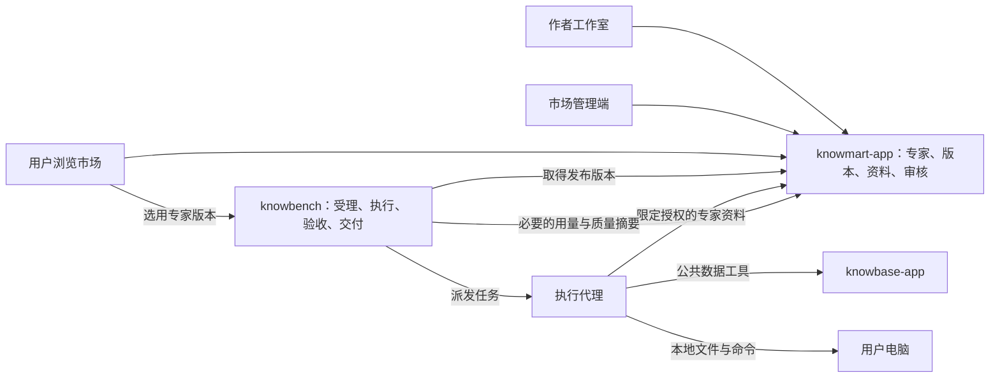

# 专家市场架构对比分析和借鉴

更新日期：2026-10-14。比较对象：WorkBuddy 专家市场、闲鱼、淘宝上的知识与咨询类服务。

用户已明确：“知识淘宝”指淘宝上的知识、咨询类服务，不是一个名为“知识淘宝”的独立平台；“咸鱼”按闲鱼理解。

本文以 SunMoonAI 现有 [0018 专家市场骨架](dev-investment-agent/tree-build/SDD/modules/0018-advisor-market.md)为基础，分析市场的供给、发布、选用、履约、评价及商业化边界。对竞品仅使用公开官方资料，未验证其内部数据库、服务拆分或完整购买流程。下文的竞品“架构”是可观察业务机制的抽象，不是对其内部实现的断言。

现有骨架注明“未实施”；本次未进行 knowmart-app（原名 advisor-app，2026-10-14 改名）的部署验收。本文中的新增对象、流程和商业方案均为讨论建议，不构成实施批准，不改变既有账号、数据归属和编排分工。整体产品比较另见[竞品比较分析](竞品比较分析.md)。

## 一、主要结论

专家市场需要同时解决三个问题：作者如何把能力变成可发布的产品，用户如何判断是否适用，平台如何证明承诺得到了履行。

| 参照对象 | 最有价值的借鉴 | 转化为我们的能力 |
| --- | --- | --- |
| WorkBuddy | 将专家及其依赖组织为可发布、可调用的能力 | 标准化专家包、兼容性声明、试跑、审核及版本维护 |
| 闲鱼 | 将非标准需求通过沟通变成交易约定，并保留争议处理依据 | 受理前澄清、委托范围确认、过程证据、交付与异议处理 |
| 淘宝知识与咨询服务 | 将内容或服务组织为可选择的商品与履约承诺 | 专家服务规格、使用权益、计价单位、售后范围与评价 |

这是我们的分析归纳。三方并非互斥：WorkBuddy 也有业务运营机制，闲鱼也有标准化交易，淘宝也有非标准咨询。

**建议把专家市场建设成“可重复提供专业服务的市场”。** 每次选用都应能确定：使用哪一版方法和资料、适合什么问题、依赖什么条件、承诺交回什么，以及失败后如何处理。

## 二、先明确我们在出售或提供什么

当前定义是一位专家由知识库和 skill 组成，其中 skill 指现有专家 profile / 专家包整体，不应直接等同于一个普通 `SKILL.md` 文件。用户通过工作台使用专家；作者维护方法和资料；工作台执行并验收。[0018 骨架](dev-investment-agent/tree-build/SDD/modules/0018-advisor-market.md)

建议进一步区分以下对象，避免市场发展后把所有东西混在“专家”里：

| 对象 | 含义 | 示例 |
| --- | --- | --- |
| 作者 | 为方法、资料和维护负责的供给方 | 某研究团队或个人作者 |
| 专家 | 长期身份与能力定位 | 财务分析与预测专家 |
| 专家版本 | 一次发布的执行内容与资料清单 | 某版方法、依赖、规则及知识库快照 |
| 服务规格 | 用户这次要完成的工作范围 | 基于月度经营数据预测未来三个月 |
| 使用权益 | 用户允许使用什么、多久、几次 | 免费试用、单次委托、订阅内使用 |
| 委托 Task | 某次实际执行 | 对某份数据完成一次预测任务 |
| 交付记录 | 此次承诺对应的结果和检查证据 | 文件位置、摘要、数据版本、验收记录 |

前四项应先讲清楚。收费权益与商业订单等，在商业模式确定后再增加；第一期无需为了未来市场提前实现完整电商系统。

## 三、竞品机制比较

### 3.1 WorkBuddy：专家能力的产品化

官方开放平台给出了开发者入驻、配置能力、测试、审核、发布和维护的流程。专家包有标识、版本、作者、Agent 定义及市场展示信息，也可声明相关能力依赖。[开放平台概述](https://open.workbuddy.cn/docs)、[专家包说明](https://open.workbuddy.cn/docs/expert)、[依赖字段说明](https://open.workbuddy.cn/en/docs/expert)

可借鉴的关键是让作者明确交付一个完整、可运行的版本，而不仅是名字和介绍。我们的发布对象应包含方法、输入要求、工具依赖、输出规格、资料版本和测试材料。

WorkBuddy 对连接器的最低客户端版本及认证方式有显式配置。这提示我们：专家版本兼容性也需要覆盖执行工具和运行环境，避免市场显示可用、开始执行后才发现不支持。[连接器说明](https://open.workbuddy.cn/docs/connector)

官方运营数据将专家召唤等行为计入安装次数，按实际次数计数而不去重。这是一种使用量口径，不能直接解释为完成任务或产生有效成果。我们的作者看板应另外统计受理、开始、交付、验收和失败原因。[运营数据说明](https://open.workbuddy.cn/en/docs/operations-data)

**待核实：** 专家收费、作者分成、独立专业验收、任务争议和退款的具体机制。本文不把未查到的内容判定为竞品缺失，也不编造商业比例。

### 3.2 闲鱼：非标准需求的约定与履约

闲鱼官方协议覆盖商品及服务发布、交易、交付、评价和争议调处，并要求交易双方事先确认交付相关事项。这些机制适合用来观察非标准供给如何形成可追查的约定。[闲鱼社区用户服务协议](https://terms.alicdn.com/legal-agreement/terms/suit_bu1_other/suit_bu1_other201708081618_51146.html)

**对我们的借鉴：** 用户输入“预测这个公司”时，系统需要先明确对象、数据、时间范围和交付形式。最终形成的是一份委托约定，而不是让专家在执行途中持续猜测。约定应能引用澄清过程，并在用户改变目标时产生新的范围记录。

闲鱼验货宝在适用品类中引入第三方查验，但这是实物类服务的特定机制，不能说闲鱼对所有知识服务都提供专业验收。可借鉴的是供给方交付与检查职责分离。[验货宝买方协议](https://terms.alicdn.com/legal-agreement/terms/product/20221213134628952/20221213134628952.html)

我们的作者可以提供测试样本与预期结果，但平台应保留独立检查。只由作者自己定义“什么都算通过”，专家市场无法积累可信的质量信息。

### 3.3 淘宝知识与咨询服务：商品承诺和经营责任

本节以淘宝知识、咨询类交易为业务参照，不将其视为统一的独立产品。具体商品可能是资料、课程访问权、咨询时间或定制成果，各自交付方式不同；这是本文的分析分类，不是淘宝官方类目表。

淘宝卖家协议明确了平台与卖家的经营关系，并将商品或服务交易及相应规则纳入体系；其诚信承诺也要求交易信用真实。我们可借鉴商品承诺、交易关联与信誉约束，但不能把平台通用协议解释为所有知识服务都有同样的退费条件。[淘宝网卖家服务协议，2026-06-02 生效版](https://terms.alicdn.com/legal-agreement/terms/suit_bu1_taobao/suit_bu1_taobao201908081502_44434.html)

| 知识服务形态（分析分类） | 用户获得什么 | 对专家市场的启示 |
| --- | --- | --- |
| 资料或课程 | 内容或访问权 | 明确授权与访问范围，不能自动视作问题已解决 |
| 咨询服务 | 约定范围内的答复与交流 | 明确问题数量、服务期限和补充沟通范围 |
| 定制成果 | 约定规格的文件或分析 | 明确输入条件、成果内容、检查方式和修改边界 |
| 持续服务 | 一段时间内的更新或支持 | 明确服务期间、更新频率、额度与终止处理 |

我们当前更接近可重复执行的定制成果服务。作者上传了多少资料、方法写了多少页，都不足以直接证明用户应购买；用户应看到这个专家能解决哪些问题、需要什么输入、产出什么。

**本次限制：** 未完成具体店铺购买，也未取得统一适用于上述知识服务的最新细分类目规则。因此不写固定退款天数、平台抽成、自动确认期限或“虚拟商品一律不退”等结论。

### 3.4 横向对照

| 维度 | WorkBuddy | 闲鱼 | 淘宝知识与咨询服务 | 我们的建设方向 |
| --- | --- | --- | --- | --- |
| 供给组织 | 专家及生态能力包 | 发布者与商品/服务信息 | 店铺与具体服务商品 | 作者、专家、版本、服务规格 |
| 选用依据 | 能力介绍、分类及任务示例 | 描述与交易沟通 | 商品说明和服务承诺 | 适用边界、输入要求、样例成果、质量证据 |
| 能力交付 | 在代理环境调用 | 按双方约定交付 | 因服务商品而异 | 工作台执行，交回可核验结果 |
| 质量机制 | 专业验收细节待核实 | 交易证据与调处；特定实物可查验 | 经营责任和信用约束；具体规则依商品 | 平台检查、领域验收、用户反馈分别记录 |
| 版本管理 | 专家包显式版本 | 不据公开材料推断内部版本机制 | 不据公开材料推断内部版本机制 | 方法、资料及验收规则随发布版本固定 |
| 商业化 | 本文未核实收费分成 | 商品/服务交易 | 商品/服务交易 | 先验证履约，再确定权益、订单与结算 |

## 四、沿用的架构分工

0018 已明确：knowmart-app 负责专家与资料的真源；knowbench 负责执行、审批、验收和任务记账；knowbase 负责公共数据。建议继续沿用，避免市场再做一套执行引擎。

图中市场用量和质量摘要是建议补充的集成，不代表已经实现。资料读取沿用按用户、专家及对话限定的授权。公共数据和作者私有资料仍分别管理；本文不建议自动上传用户本地知识库。

| 职责 | 建议唯一归属 | 说明 |
| --- | --- | --- |
| 专家资料与发布版本 | knowmart | knowbench 保存执行所需的版本引用与记录，不另起编辑真源 |
| 委托、Attempt、审批及执行事件 | knowbench | knowmart 不直接修改任务状态 |
| 公共数据版本与指标口径 | knowbase | 作者不能借专家发布修改公共数据 |
| 模型消耗与运行成本记录 | 现有工作台计量体系 | 作者收益不能直接等同模型费用 |
| 市场评价、作者用量与发布质量摘要 | 建议由 knowmart 管理 | 来源为受信执行记录；不复制完整用户对话 |
| 商业订单、退款与作者结算 | 商业化前另行确定 | 不为本次比较新增应用；也不直接塞入 Task 状态机 |

跨应用使用契约接口和可重放事件，不直接读取对方数据库。若增加摘要事件，使用唯一事件标识去重并支持对账，避免重复计费或遗漏统计。[平台约束](dev-investment-agent/tree-build/rules/constraints.md)

## 五、专家发布应固定哪些内容

骨架已经规定专家版本不可改写。建议把版本从“方法版本”补全为“可执行发布清单”，至少覆盖以下内容：

| 内容 | 应记录什么 | 避免的问题 |
| --- | --- | --- |
| 身份与服务说明 | 专家、作者、服务规格及适用边界 | 同名专家或宣传变化导致承诺不清 |
| 方法与步骤 | 工作流、步骤输入输出、失败处理 | 作者更新后在途任务含义变化 |
| 资料清单 | 专家资料及作者共享资料的固定版本、摘要值 | 方法未变但知识内容悄悄变化 |
| 依赖与兼容性 | 工具、授权、操作系统、必要运行时及已验证模型范围 | 发布后才发现无法运行 |
| 验收规则 | 作者提交的检查与平台要求的独立检查 | 自定宽松规则掩盖错误 |
| 评测证据 | 数据版本、样本范围、时间、模型和检查结果 | 把一次成功宣传成普遍有效 |

作者私有知识库中的同一资料可以被多位专家引用，但发布时应固定各自引用版本。作者更换或删除资料时，应区分停止新引用与历史任务所需证据的保留；若确因权利或安全问题必须撤回，要标明旧任务无法完整复现，不能继续承诺可用。

“记录了模型版本”也不保证生成结果完全一致。复核应以当次输入、取数结果、计算记录和交付快照为依据；重跑用于比较，不宣称逐字可复现。

### 发布流程建议

草稿 → 结构与依赖检查 → 作者试跑 → 平台独立评测 → 审核 → 发布。

这是一条建议流程，不是新增的正式状态枚举。发布前至少覆盖正常输入、信息不足、缺少依赖、执行失败和不适用问题；作者自测与平台结果分别保存。试跑使用专门测试数据和环境，不读取真实用户项目。

专家下架应区分普通停止销售与紧急撤回：前者是否允许在途任务继续，可按既定承诺处理；后者需要停止相关授权和执行，并给出原因。两种情况都应保留已有交付的必要记录，不通过静默替换专家版本“修复”历史。

## 六、从选择专家到完成服务

### 6.1 受理前说明工作范围

专家详情页建议围绕用户的决定展示：能解决什么、需要什么、交回什么、什么时候不适用、依赖哪些授权、费用由哪些部分组成，以及样例成果和质量记录。

例如“财务分析与预测”范围太大。可以先明确为“基于已提供的连续月度经营数据，预测未来三个月收入与成本”；如果要支持上市公司财报，应另行确认适用方法与检查要求，不能仅靠相同名字兼容所有数据。

用户选择服务后，将研究对象、时间范围、数据版本、交付内容和允许的补充步骤固定到本次委托。信息不足先澄清，不擅自换公司或数据集。澄清应尽量少，但足以避免交付方向错误。

### 6.2 保持不同状态的含义

| 事实 | 不能据此宣称什么 |
| --- | --- |
| 用户选中了专家 | 已经开始执行或应该收费 |
| Task 被受理 | 环境已经就绪、一定能够完成 |
| 模型停止输出 | 成果完整且正确 |
| 文件已写入 | 文件内容满足专业要求 |
| 自动验收通过 | 用户已认可，也不等于付款应立即结算 |
| 用户提出异议 | 可以修改历史 Task 终态来消除记录 |

已有 Task 终态继续遵守原状态机。商业化后，可由交付、订单和争议记录表达后续处理，避免给一个 `SUCCEEDED` 字段同时赋予技术成功、专业正确、用户确认和作者收款四种含义。

### 6.3 交付证据与异议

建议将委托约定、专家版本、资料版本、成果引用、检查结果及实际费用汇总成可查的交付记录。用户看到结果和局限，作者默认只看到必要的使用与质量摘要。

本地文件可被用户继续修改，因此文件路径本身不应是唯一证据。应记录交付时的摘要值和必要元数据；若需要完整成果副本用于争议处理，需先明确保存位置、访问权限及用户授权，不能默认复制完整用户文件到作者侧。

争议可以先按环境故障、数据问题、方法错误、成果缺项和新增需求分类。技术失败与作者质量问题分别记录，避免平台故障拖低作者信誉，也避免把真实方法错误归为“用户不满意”。

## 七、知识库与授权：现有骨架需要澄清的地方

本节是对已读文档的设计检查，不代表已经发现对应线上漏洞。

| 项目 | 当前骨架或文档表现 | 建议澄清 |
| --- | --- | --- |
| 资料与专家版本 | 专家版本不可变，资料也有版本，但发布绑定范围未完全展开 | 固定整份资料清单，包含作者共享知识库的挂接版本 |
| 授权结束 | 写了终态令牌作废，示例为签名 token 与过期字段 | 明确撤销检查或授权状态校验；仅靠未到期签名不能即时撤销 |
| 反复使用同一对话 | 授权按用户、专家、对话限定 | 补充任务或授权批次的生命周期，旧授权不能因新任务开始自动复活 |
| 跨应用回跳 | 0018 示例传 `return` 地址，共用规则禁止从链接接受回跳地址 | 沿用 `from/ref` 与服务端登记目标，不能直接照搬示意 URL |
| 跨应用登录 | 用户侧市场要认 knowbench 身份，作者另有独立账号体系 | 明确会话受众和校验契约；同一身份供应商不等于 cookie 可直接复用 |
| 知识库保密 | 用户不直接看到原件，但代理能读取内容 | 区分访问隔离与内容保密，不能承诺进入模型上下文后绝不外传 |

参考：[0018 骨架](dev-investment-agent/tree-build/SDD/modules/0018-advisor-market.md)、[跨应用跳转规则](dev-investment-agent/tree-build/SDD/architecture/cross-app-links.md)。

关于知识库保密，建议保持按需检索、引用粒度和读取范围控制，并对直接索要整库的使用建立明确规则；但这些不构成“模型读得到、用户就绝不可能获得”的证明。真正必须保密的方法或计算，可以评估以受控服务返回必要结果，其复杂度与收益需另行判断。

资料权限也应覆盖引用范围：作者能上传不等于有权转授权给其他用户的模型读取。应在发布时说明资料来源及允许的使用方式，并设计撤回流程。这里讨论的是市场内容授权机制，不代替具体法律判断。

两套账号体系沿用所有者既定方向；本次不提出合并。作者访问买方材料仍需独立、明确的授权，不能因用户选用了某位专家就自动开放项目文件。

## 八、评价、发现与作者经营

### 8.1 质量与热度分开

建议市场至少区分以下几类信号：

| 信号 | 用途 | 主要限制 |
| --- | --- | --- |
| 浏览、收藏、选用次数 | 衡量被发现和尝试的情况 | 不等于成功交付 |
| 受理与完成情况 | 衡量执行可用性 | 应区分拒绝、用户取消和平台故障 |
| 领域检查结果 | 衡量专业质量 | 要有样本范围及规则版本 |
| 用户评价 | 衡量实际体验和适用程度 | 可能受期望、服务态度和样本选择影响 |
| 复用与持续使用 | 衡量重复价值 | 可能受价格、曝光和用户构成影响 |

评价关联真实使用记录和专家版本，同时显示样本量和时间范围。新版本不能无条件继承旧版质量结论。推广位置应与质量排序分开；不以“召唤次数最多”自动等同“最可靠”。

不建议一开始就用复杂公式合成一个专家总分。先展示适用场景、少量有解释力的质量指标及样例成果，更容易发现问题。

### 8.2 作者看板

作者需要知道哪些任务适用、哪里经常失败、哪个版本改善了效果。建议提供聚合的使用趋势、失败分类、费用与耗时分布、用户自愿反馈及版本比较。

统计口径要防止排除所有失败后再报高成功率。至少同时报告提交数量、受理数量、环境阻断、开始执行数量与合格交付数量。低样本量要明确显示。

不默认向作者开放用户原始问题、项目内容和完整工具日志。确需排障时，由用户选择提供脱敏案例，且与常规运营统计分开。

### 8.3 冷启动建议

第一期沿用平台自营作者，先上架少量有明确适用范围和可复核样例的专家。邀请外部作者前，先验证一位新作者能否完成建专家、上传资料、试跑、修订、审核和发布全过程。

供给扩张应跟随真实需求和质量维护能力。专家数量增长本身不构成市场成立的证据；更值得观察的是合格交付后的复用及作者持续维护意愿。

## 九、商业化边界：先定义权益，再讨论分成

0018 明确未设计分成、计费和作者间复制。以下仅比较候选方式，不选定方案，也不设定价格。

| 方式 | 适合的价值 | 必须先讲清的问题 |
| --- | --- | --- |
| 按次使用 | 边界明确的一次委托 | 受理失败、重试、取消是否消耗权益 |
| 按成果收费 | 可检查的交付规格 | 什么算合格、修改与异议如何处理 |
| 订阅 | 高频使用或持续更新 | 使用额度、资料更新、停订后历史成果访问 |
| 企业授权 | 固定团队或组织使用 | 授权主体、席位或用量边界、管理权限 |

专家服务费、模型费用和其他数据费用需要区分。可以组合展示给用户，但内部要能解释钱花在哪里。现有模型消耗账不能直接成为作者分成账。

如果未来收费，建议使用独立商业订单与 Task 关联：一次订单可以按服务约定覆盖执行和修订，失败 Attempt 不自动产生新订单。支付回调、退款及作者结算要各自幂等，技术成功不直接触发不可撤回结算。

支付能力应通过适合的支付服务接入；本文不建议自行保管交易资金。平台费、支付费、失败成本由谁承担，以及争议期间何时结算，均应在商业化前单独确定。

## 十、分阶段落地建议

### 阶段一：证明专家能发布、能用、能交付

在现有 M1—M5 骨架上先补齐发布清单、兼容性检查、资料绑定、授权撤销和回跳规则。继续使用自营作者，收费系统暂不作为前置条件。

建议验收示例：

- 从空白创建专家，试跑后发布；普通用户选中后正确回到原项目。
- 创建任务时固定实际可用的专家版本，不落到缺失的默认旧版本。
- 新版发布或资料更新不静默改变在途任务；引用能定位原版本。
- 未获授权的对话无法读取资料，任务结束后新读取立即被拒绝。
- 文件存在且专业检查通过后才宣称完成；环境故障给出准确状态。

### 阶段二：开放少量外部作者

增加作者入驻、内容来源说明、独立审核、投诉撤回、质量看板和用户评价。先验证作者维护成本及用户复用，再扩大供给。

### 阶段三：验证付费与结算

在服务规格与验收稳定后，再确定权益、计费、订单、退款及作者收益。以能够解释每一笔订单的承诺、执行和结算为完成标准，不以支付按钮上线为完成标准。

### 阶段四：按需求扩展市场形态

根据真实使用情况评估企业授权、专家组合、更多连接器或人工补充服务。专家团不作为首期市场成立的必要条件；若引入，需额外定义成员版本、失败责任、成果整合和费用归属。

## 十一、尚需单独决定的问题

| 问题 | 本文建议的讨论起点 |
| --- | --- |
| 首批出售什么价值 | 从范围明确的研究成果或使用权益选起 |
| 自动验收与用户确认的关系 | 技术检查、专业检查、主观体验分别表达 |
| 作者承担什么维护责任 | 依赖变化、资料时效、方法错误分别约定 |
| 下架后如何处理旧任务 | 普通下架与紧急撤回分别处理 |
| 历史资料保留多久 | 权利范围、复核需要和存储成本一起考虑 |
| 用户能看到多少方法与资料 | 用可验证成果建立信任，不承诺无法证明的绝对保密 |
| 什么时候开放收费 | 先有稳定履约和异议处理，再验证商业模式 |

## 十二、来源与使用限制

官方资料核查日期：2026-10-14。部分 WorkBuddy 页面依据搜索工具取得的官方正文摘录，运营数据页已直接打开。淘宝与闲鱼协议用于识别公开业务机制，不作为某一类知识服务具体规则的替代，也不代表已核验各品类的实际售后流程。

| 来源 | 支持的内容 |
| --- | --- |
| [WorkBuddy 开放平台概述](https://open.workbuddy.cn/docs) | 开发者入驻、测试、审核、发布与维护 |
| [WorkBuddy 专家包](https://open.workbuddy.cn/docs/expert) | 包结构、版本和展示信息 |
| [WorkBuddy 专家依赖说明](https://open.workbuddy.cn/en/docs/expert) | MCP 与连接器依赖 |
| [WorkBuddy 连接器](https://open.workbuddy.cn/docs/connector) | 运行依赖与兼容版本 |
| [WorkBuddy 运营数据](https://open.workbuddy.cn/en/docs/operations-data) | 使用量统计口径 |
| [闲鱼社区用户服务协议](https://terms.alicdn.com/legal-agreement/terms/suit_bu1_other/suit_bu1_other201708081618_51146.html) | 发布、交易、交付、评价和调处 |
| [闲鱼验货宝买方协议](https://terms.alicdn.com/legal-agreement/terms/product/20221213134628952/20221213134628952.html) | 特定实物品类的第三方查验参照 |
| [淘宝网卖家服务协议](https://terms.alicdn.com/legal-agreement/terms/suit_bu1_taobao/suit_bu1_taobao201908081502_44434.html) | 卖家经营关系及交易信用要求 |
| [0018 专家市场骨架](dev-investment-agent/tree-build/SDD/modules/0018-advisor-market.md) | 已定方向与尚未展开的设计 |
| [Profile 与扩展](dev-investment-agent/tree-build/SDD/architecture/profile.md) | 任务绑定 Profile 与专家包版本 |
| [跨应用跳转](dev-investment-agent/tree-build/SDD/architecture/cross-app-links.md) | 回跳地址与身份参数边界 |

后续应补充三项验证：WorkBuddy 作者实际发布流程、闲鱼或淘宝知识服务的完整履约案例、我们自己的作者到用户交付演练。验证完成后，将观察结果与本文建议分开记录，再决定哪些建议进入正式设计。
