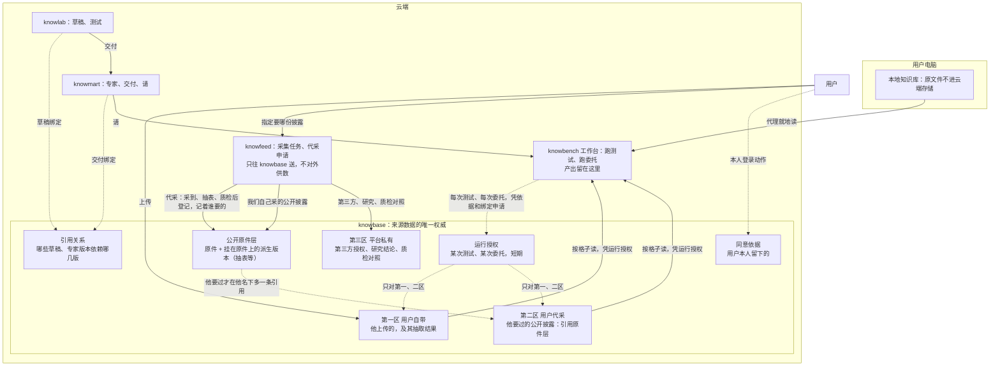

# 数据拓扑：knowbase 是云端来源数据的唯一权威

> Opus 2026-10-18 第三版。经过：远程 Fable 初稿 → Opus 重写 → Fable 两轮复审 → 外部审稿人九条意见（Fable 逐条判过） → 本版。所有者：「是甲」「你重写一版」「按你的建议」「都按你的建议，重写吧」。
>
> **本页只定架构**：数据放在哪、归谁、谁能读、怎么进来、怎么删、合规上怎么说。不谈实现，实现等架构定了再谈。决定记录见 `decisions.md`「数据拓扑」。
>
> 相关：[`拓扑.md`](拓扑.md)（网络拓扑）、[`constraints.md`](dev-investment-agent/tree-build/rules/constraints.md)（C-D 数据规矩、C-L 合规边界）、SDD 0026（knowlab）、0027 §3.5（契约 `knowbot-data/v1`）、0032（knowmart 专家目录）。

## 一、为什么改

现在来源数据有两个真源：
- knowbase：knowfeed 采来的；
- knowlab「我的数据」：用户上传的，存在 knowlab 自己的存储里。

这违反我们自己的规矩：主档只有一份，别处只存引用和版本（C-D1、C-D14）。

10-16 定「数据来自用户上传的数据」，是为了合规：平台不给用户投资数据。所有者 10-18 的判断是，守住这条不必靠「必须上传」，靠「数据是谁选的」就够：**平台不提供数据，只按用户的指定取回公开披露。**

## 二、范围：knowbase 管什么，各应用管什么

**knowbase 是云端来源数据及其版本、访问授权的唯一权威管理方。** 各应用仍管自己的业务记录：

| 谁 | 管什么 |
| --- | --- |
| knowbase | 来源数据（原件、派生版本、用户上传的）、版本、所有者、引用关系、同意依据、运行授权、读数留痕 |
| knowfeed | 采集任务、代采申请的生命周期 |
| knowlab | 想法、草稿、测试（以及草稿绑定了哪些数据版本） |
| knowmart | 专家、版本、交付、请专家（以及每一版绑定了哪些数据版本） |
| knowbench 工作台 | 产出（专家交回的底稿、结果）、会话记录、委托 |

「只有一个真源」不排斥备份、缓存和检索索引，但它们必须标明来自哪个版本，不能各自改成另一份主档。

**「用户」是谁**：本页说的用户、所有者、授权里的用户，都是 Casdoor 组织 sunmoonai 里的同一个主体。一个人在 knowlab、knowbench、knowmart 里是同一人，三个应用共用。分组织、实名认证是以后的事（10-18 定）。

**「知识库」一个词指了四样东西**，分开说：

| 东西 | 是什么 | 在哪 |
| --- | --- | --- |
| 本地知识库 | 用户电脑上的一个目录，本地代理就地读 | 用户电脑，见第八节 |
| 来源数据 | 表、财报、用户上传的文件 | knowbase |
| 产出 | 专家交回的底稿、结果 | 工作台。它是结果，不是来源；用户想拿它当数据再用，就上传进 knowbase 第一区 |
| 专家清单 | 方法、规则、引用了哪些数据版本 | knowlab 做、knowmart 存；只存引用，不存数据 |

knowbase 是我们的系统；里面分区，前两区的数据归用户。

## 三、拓扑图

实线是数据流向，虚线是依据、绑定与授权。



## 四、knowbase 里的东西

### 4.1 原件、派生版本、三区

| 内容 | 归哪 | 谁能读 |
| --- | --- | --- |
| 公开披露原件 | 共享的公开原件层 | 只经用户第二区的引用 |
| 原件的识别、抽表、标准化结果 | 挂在原件上的**派生版本**，也在原件层 | 同上，经第二区的引用 |
| 用户上传的文件及其抽取结果 | 第一区 | 他本人，或凭运行授权 |
| 第三方授权的数据、平台研究结论、内部质检对照 | 第三区 | 只有管理端和内部工具；**一律不接受授权** |

三区管的是谁看得见、谁能读，不管东西存在哪：

| | 第一区 用户自带 | 第二区 用户代采 | 第三区 平台私有 |
| --- | --- | --- | --- |
| 从哪来 | 用户从工作台或 knowlab 上传 | 用户指定，knowfeed 从白名单里的法定披露渠道取回；原件已经有了就直接给他一条引用 | 我们自己的 |
| 归谁 | 这个用户 | 这个用户（原件是公开的，「他要了这一份」这条事实归他） | 平台 |
| 别人看得见吗 | 看不见 | 看不见：没有目录、不能浏览、不能搜「谁要过什么」 | 用户不知道有这一区 |

公开原件即使是我们自己的采集任务采来的，用户也只能经自己的代采引用拿到；第三区真正专属的只剩第三方、研究和质检对照。原件打通了，硬隔离还在。

**用户上传的文件，不会因为内容和某份公开原件一样就自动进公开原件层。** 第一区的东西永远只在第一区。

### 4.2 版本：原件版本和派生版本分开固定

- 原件有版本，派生版本也有版本，各自固定，专家绑的是具体的「原件版本 + 派生版本」。
- **换了抽取器、修正了数字，产生新的派生版本，不改旧的。** 已交付的专家继续读旧版本；作者升级到新版本，要重新测试，出新一版专家。
- 抽取结果被发现有错：标记受影响的版本，通知引用它的草稿和专家的作者，不覆盖旧结果。

### 4.3 原件怎么认、更正、去重

- 原件除了「渠道 + 发行人 + 报告 + 期间 + 版本」，还要记来源标识、获取时间、内容摘要。
- 来源网站换了同名文件：新增一个版本，旧的保留。
- 公司发更正公告：算这份报告的新版本，旧版本保留；绑旧版本的专家照旧读旧版本，提醒作者有新版。
- 同一份报告来自两个渠道：两条来源记录都保留；确认内容相同后，可以共用文件内容。

## 五、谁能读：同意依据、绑定、运行授权三层

读数据有好几种情况：作者看自己的数据；作者的草稿在测试；已交付的专家被请去运行；辅助孵化；以后（三期）别人请这位专家。草稿、交付、请专家是 knowlab、knowmart 的概念，knowbase 不去理解它们怎么工作，但要懂一套通用的授权范围。

### 5.1 读的规则

区对（第一、二区），并且下面两种之一，否则当这份数据不存在：

- **本人**：请求里带着用户本人的登录凭据（他在工作台或 knowlab 页面上看、管自己的数据，应用只是转交）。光有服务身份加一个用户名，不算本人。**这条机制现在没有，是新加的**，要让 knowbase 能验用户本人的凭据。
- **凭运行授权**：任何应用凭服务身份替他读（测试、委托、辅助孵化），一律要有一条有效的运行授权。

调用方另核一遍。

**同一套检查适用于一切取用方式**：按格子读、下载、预览、导出、检索、缓存返回，都按对象核一遍，不能只核数据集编号。检索尤其要守：第一区的内容不能从检索口漏给别人。

### 5.2 三层是什么

| 层 | 是什么 | 谁留下 | 能不能拿来读 |
| --- | --- | --- | --- |
| 同意依据 | 用户同意「这几版数据可用于这个草稿 / 这一版专家」 | **用户本人的登录动作**（在 knowlab 挑数据、绑版本时），不能由应用代填 | 不能 |
| 绑定（引用关系） | 某个草稿、某一版专家依赖哪几版数据 | knowlab（草稿）、knowmart（交付），必须落在某条同意依据的范围内：绑草稿时的同意覆盖这份草稿，以及由它原样交付的专家版本；绑定变了（换了数据或版本），要重新同意 | 不能 |
| 运行授权 | 某一次测试、某一次委托可读哪几版 | 工作台凭同意依据和绑定申请，knowbase 签发 | **能，只有它能** |

**运行授权的种类**

| 种类 | 什么时候申请 | 谁来读 | 可读什么 | 到什么时候失效 |
| --- | --- | --- | --- | --- |
| 测试 | 每次测试开始前 | 工作台，这次测试的编号 | 草稿绑定的那几版 | 测试结束就撤；兜底：那次测试的时限加等人的最长时间 |
| 委托 | 每次请专家时 | 工作台，这次委托的编号 | 这一版专家绑定的那几版 | 这次委托结束就撤；兜底：委托的时限 |
| 孵化 | 辅助孵化开始时 | 工作台，用户自己的沙箱 | 只读数据的格式（表头、报告期），不读内容（待办 K23、K28）。这时还没有草稿和绑定，依据就是用户本人发起孵化的那一步（带本人凭据），范围只到格式 | 孵化结束就撤 |

### 5.3 守则

1. **同意依据只能来自用户本人**：授权里的用户身份和他的同意，必须来自能验证的用户凭据或已有的同意依据，不能由调用的应用自由声明。否则一个出错的 knowlab 可以把两边都填成甲，让乙的测试来读。
2. **运行授权只能在同意依据和绑定的范围内**，范围只能更小，不能更大。
3. **哪个应用只能做哪件事**：knowlab 只能写草稿绑定，并转交用户本人的凭据去写同意依据（自己不能代写）；knowmart 只能写交付绑定；工作台只能申请运行授权；越界就拒。
4. **委托凭据要保留「用户是谁」和「代办应用是谁」**，由 knowbase 自己验证。不转发浏览器 Cookie、ID Token，也不默认各应用的登录令牌通用。具体用哪种机制（OAuth 令牌交换 RFC 8693，或由 knowbase 自己签发），实现时先核 Casdoor 支不支持再定。反例就在现网：工作台用自己的密钥签发「knowbase MCP 令牌」，里面的用户是工作台自己填的，knowbase 只验签名就信。这张令牌已定要撤（第十五节）。
5. **授权给别人要有作者的同意**：一期只给所有者自己用（他的测试、他自己请他的专家）。到三期被授权的人不是所有者时，还要核作者有「公开时同意请的人看到被用到的数」那条同意依据（10-18 守线），没有就拒。
6. **第三区一律不接受授权**：这是结构上的规矩，不是靠没人去写。
7. **能撤，也有兜底的上限时间**：撤销消息丢了，到点也自动失效。
8. **申请不到就不开跑**：测试、委托拿不到运行授权就不开始；确认不了授权有效就停止读取，不能退回旧接口绕过检查。
9. **每次读都留痕**：谁读、凭哪条运行授权、读了哪个数据集哪一版。按调用记，不按格子记；只记编号，不记数值；**留一年**，律师答复后再调。这是「用户选、平台跑腿」的另一半证据。

### 5.4 别人请专家时读哪一版

专家绑了作者的数据（包括作者代采的），三期别人请这位专家时，凭委托运行授权读**作者绑的那几版**，不改读请的人自己名下的。否则同一位专家换个人请，读到的版本就不一样，测试结果没法复现，交付时的验收就白做了。一期还是只有所有者自己请。

## 六、引用关系与删除

**引用关系和运行授权分两样记**：引用回答「哪些草稿、专家版本依赖这份数据」，授权回答「现在谁能读」。删不删看引用，谁能读看授权。

**删除的流程**（用户要删第一区的数据，或删第二区的一条引用）：

1. 先显示受影响的东西：哪些专家版本绑着它，有哪些测试、委托正在跑。
2. 所有者确认后，**先阻止**：不再接受新的运行、不再签发新的运行授权。
3. 正在跑的允许跑完，最长到它那条运行授权的期限（所有者定）。
4. 下架绑着它的专家版本，撤掉运行授权。
5. 最后删除：第一区删数据，第二区删他的引用（原件不动）。

**撤销只能挡住以后的读取**：已经交给运行进程的数据不会自动消失，留在那次产出和会话记录里，按它们的留存规则处理。

**跨应用的步骤有「处理中」状态**：下架、撤权、删除都要有能查到的处理中状态，可以安全重试；没做完之前，不重新开放读取。沿用现有的发件箱、收件箱和幂等机制，不另外加一套协调系统。

**账号注销**：第一区删除，第二区的引用删除，运行授权全撤，他已交付的专家下架（照上面的流程）。**导出**：他自己第一区的数据随时可以导出。

## 七、代采申请：用户指定，平台跑腿

9 月 29 日建的「申请入库」就是这条路，现在接到第二区上，并把「谁要的」一起留下。

```text
用户在工作台「信息采集」或 knowlab 选数据时指定：茅台 2023 年报
（选项来自披露渠道的公开索引，不来自我们库里有什么）
        │
        ▼
原件层已有这一份？ ──是──▶ 在他名下记一条引用（第二区）
        │否
        ▼
knowfeed 建采集任务 → 采、抽表、质检
        │
        ▼
knowbase 登记原件与派生版本（带出处、质检结果、谁要的），他名下记一条引用
```

- **代采申请归 knowfeed**，有自己的生命周期：要了 → 排队 → 采到 → 质检 → 进了他名下，全程留痕。合规证据就在这条记录里。
- **中途失败可以补**：原件存好了、引用没登记上，重试时补上引用，不重新下载，也不生成重复的数据集。
- **命中与否给用户看的内容一样**，不显示「别人要过」。命中秒到、没命中要排队，快慢看得出平台取过这份公开文件，但分不出是谁要的。
- **第一版**（所有者定）：只开巨潮一个渠道的 A 股定期报告（年报、半年报、季报），只抽三张报表；不限公司，用户点哪家采哪家；按来源自动受理，**不按公司清单**（取消 10-15「关注清单自动批准」）。
- **配额**：命中已有的只免下载和抽表的成本，请求频率、每人引用的数量仍然有限制。
- **只能由用户发起**，运营不能替他加。
- **质检结果给用户看**，哪几项没对上照实标；原件照样给。

## 八、本地知识库

**承诺这样写**（所有者定）：本地知识库的原文件**不上传到云端数据存储**；执行任务需要的内容片段，会发给模型（用的是用户自己的 key，在他自己的沙箱里），并留在会话记录里，留存按会话记录的规则。

不承诺「任何内容都不离开本机」：那要本地模型，现在的架构做不到。

**本地和云端来回**：
- 用户可以把自己第一、二区的东西下到本地（他自己的、公开披露）。
- 凭运行授权读到的别人的数据（三期作者绑的），不能整份下载，只看到被用到的数（10-18 定）。
- 本地的东西想给云端专家用，就上传进第一区。

## 九、knowbase 的职责、地位与故障规则

- **职责**：从「平台数据的加工入库加检索」变成「来源数据的主档」，第二节那张表的第一行。检索和索引是派生的（C-D5）。
- **检索坏了不挡读数**：检索不可用时，仍可按固定版本直接读来源数据（C-D15）。
- **确认不了授权就停**：不退回旧检索接口绕过检查（守则 8）。
- **一级服务**：每次测试、每次委托都要经过它。冷建时备份和恢复排在别的应用前面；上线门那条（备份能恢复、做过一次恢复演练，C-R10）先过它。
- **恢复要覆盖全部**：数据文件、版本元数据、同意依据、引用关系、运行授权和撤销记录。不能只证明对象存储的备份能打开。恢复演练要专门核：恢复旧备份后，已撤销的授权不会重新生效。
- **空间上限**在 knowbase 按用户算：第一区按实际占用；第二区只是引用、共用原件，不计入他的空间，只受代采的配额限制。
- **检索索引也分区**：用户上传的文件做检索，索引按区和所有者分开，一个索引里不混区。

## 十、抽表是加工：每个数都能追回原件的哪一页

取回原件是跑腿；从 PDF 里抽数字是平台在加工，抽错了就是平台带进来的错。原件和派生版本都会被多个用户复用，所以每个数都要能追回原件的哪一页，质检没对上的照实标出来。这是复用说得过去的前提，也满足原始证据先存、带出处（C-D13）和《金融信息服务管理规定》的「来源可追溯」。

## 十之一、年报怎么入库、模型怎么读（2026-10-19 补）

> 所有者：「能不能把 pdf 先经过 rag 然后变成数据库 mysql，模型要数据读 mysql」；Opus 建议数字走抽好的表、文字走检索、都放 PostgreSQL；所有者「好，写进数据拓扑设计」。起因：K19 第 2 稿第 6 步专家读年报，「主要会计数据」那张表落在工具结果被省掉的中间，读不到（待办账 137）。

一份原件（年报、季报、半年报）进来后，留**三种读法**，都挂在这一版原件上，都能追回原件的哪一页：

| 读法 | 是什么 | 给谁用 | 怎么读 |
| --- | --- | --- | --- |
| 抽好的表 | 派生版本：每张报表一张表，行是科目、列是期间，每格是原文的数，带单位、合并或母公司、原件页码 | 数字：三张表、主要会计数据、非经常性损益这类 | 按「表、科目、期间」取格子，计算一律交计算工具（0030），模型不抄数 |
| 文字检索 | 派生的检索索引：原文按段切好，每段带页码 | 文字：经营情况、风险、渠道、会计政策这类 | 按意思找出几段原文，引用时带页码 |
| 原文按页 | 原件抽出的文字，按原件的页切，每页在模型一次看得到的大小以内 | 核对、找不到时兜底 | 按页读 |

- **数字不走检索**：检索按意思相近找段落，适合文字，找精确的数不可靠（可能找错段、把两年的数混在一起）。数字一律走抽好的表。
- **放在 knowbase，用 PostgreSQL**：和平台其余部分同一种数据库，不另起 MySQL（多一种数据库就多一套运维、备份和恢复演练）；文字检索的向量也放 PostgreSQL，具体用什么做到实施时再定。检索和索引是派生的，坏了不挡按固定版本读表、读原文（第九节、C-D5、C-D15）。
- **抽表要自查，自查不过照实标出**：勾稽平不平、方法要用的科目每期都有没有、单位写了没有。没过的格子标出来，模型取到时看得见「这一格质检没对上」，不悄悄混进去。2026-10-19 Opus 手工整理茅台数据时漏过一处折行（2025 年归母权益合计被拆成两行，主行是空的），就是靠这类自查才补上的（0029 `data-prep/README.md`「2026-10-19 修订」）。
- **改了抽取就是新的派生版本**（4.2）：已交付的专家照旧读它绑的那一版。
- **核抽取对不对，入库时由平台做，用独立的办法**（2026-10-19 补，见下「同一来源核不出错」）：
  1. **两种读法互核**：一套固定程序按版面抽表，一套模型读，两套逐格比，对不上的标出来交人看。两种读法错法不同，很难错成一样。
  2. **报表自己的勾稽**：资产 = 负债 + 所有者权益；净利润从利润表接到所有者权益变动表；期末现金和现金流量表接得上；同一个数在「主要会计数据」（第二节）和报表（第十节）两处印的要相等。单位看错、本期上期列抄反，这些等式就不成立，不靠第二份来源也看得出。
  3. **人核过的数进测试用例**：人对着原件核几个关键数，写进用例期望，这是独立于抽取的答案。
  核的结果照实标在格子上（同上一条），专家不再每次跑时自己核一遍。

**同一来源核不出错**（2026-10-19，所有者：「用户上传的是年报，我们抄，抄完核年报时还是解析年报再比对，因此要错都错，要对都对啊」）：K19 第 2 稿第 6 步「对照官方披露」，拿用户表里抄的「主要会计数据」回年报原文比、再拿三张表和它比。表是照年报抄的（0029 `data-prep/`），回头又读同一份年报，系统性的错（单位、列、科目认错行）抄时错了核时照样错，只查得出零星笔误；「抄的和原文一致」与「差值算不算对得上」两处还是专家自报，平台不核。所以：抄得准不准归入库（上一条），不算对照官方披露，原来那条「对照年报会变成表对表」作废。

**对照年报披露应该比什么**（所有者 2026-10-19：「应该是根据分析的结论到年报里找公司管理层讨论，让模型判断我们的财务分析和公司管理层在年报里自己的披露是否一致」）：拿专家的分析结论，到年报「管理层讨论与分析」里找管理层自己怎么说，判断一致、不一致还是年报没提。这是方法，归用户（C-L1），怎么进第 3 稿另走用户那条路；数据这边要备好的：
- 走**文字检索**那种读法：按结论去找管理层讨论里的段落，每段带页码；
- **引文平台核**：专家引的每段原文带页码，平台回原件那一页找这段字，找不到就不过——判断是模型做的，引的话是不是年报里真有、在哪一页，平台核得了；
- 只描述一致与否，不评好坏、不给买卖建议（同各步的方法约束）。
- **模型读的东西要在它一次看得到的大小以内**：表按页、原文按页、检索结果按条数，都留出余量；放不下就分页，不让中间被省掉（待办账 137）。

**顺序**：按第十五节，这一节在第 4 步「写设计」时细化成实施方案，第 5 步「搬家」时连同 knowfeed 要补的抽表五条一起做。现在用户上传的 Excel（第一区）照旧按格子读，PDF 照旧按页读。

## 十一、我们自己怎么用数据

- **孵化「财务分析与预测」**：只能以普通用户账号（sig-am）走第一、二区，不抄第三区的近路。
- **工程测试**（C-L3 允许用我们的数据）：要用就复制一份，以测试账号上传进它自己的第一区，不给第三区开例外。
- **第三区**只给管理端和内部工具用，用户的专家、用户的沙箱都到不了。

## 十二、合规上怎么说

| 环节 | 谁做 | 平台的角色 |
| --- | --- | --- |
| 选哪家公司、哪份报告 | 用户 | 不选、不推荐、不预置清单、不给别人看目录 |
| 同意哪些数据给哪个专家用 | 用户本人 | 只记下他的同意 |
| 取回公开披露原件 | 平台 | 跑腿 |
| 整理成表 | 平台 | 加工：不改数、每个数带出处到页、质检结果照实写 |
| 怎么算、怎么判断 | 用户的专家（方法来自用户） | 只提供计算工具 |
| 结果给谁 | 用户自己 | 不给别人、不拿去宣传 |

- **C-L2**：「平台不提供数据，只按用户指定取回公开披露；用户的专家只读它有权读的第一、二区数据（所有者本人的，或凭授权的），第三区不可达」，取代 10-16「数据来自用户上传的数据」那半句。
- **第三区硬隔离查得出来**：授权接口拒第三区，用户的专家和沙箱的服务身份到不了第三区。
- **《金融信息服务管理规定》**（网信办，2019-02-01 施行）：我们可能算「金融信息服务提供者」，要配审核人员、内容审核和信息安全制度，来源要能追溯，不得传播虚假金融信息。
- **律师问题**见 0026「五、合规分析」：第 1 问按「用户指定公开披露、平台代为取回并整理成表、方法来自用户、结果只给用户自己」来问，并问「荐股软件」规定的范围；第 9 问问金融信息服务。答复回来之前，第二区只收法定披露渠道的原件，不收行情、第三方整理的数、评级、一致预期。

## 十三、不变的

- 本地知识库的原文件不进云端存储（承诺见第八节）。
- 工作台的产出留在工作台。
- 专家清单只放引用。
- 用户的方法只来自用户（C-L1）；专家只归用户自己，直到三期拿到资格、问过律师。一期只有所有者自己用自己的专家和数据，三期的跨用户授权是写明了的扩展边界。

## 十四、已定的（所有者 2026-10-18）

1. 甲：knowbase 是我们的系统，是云端来源数据及其版本、访问授权的唯一权威；各应用管自己的业务记录（第二节）。
2. 三区：前两区按用户隔离，第三区用户的专家不可达、一律不接受授权。
3. 公开原件和派生版本在共享原件层，只存一份，经第二区引用访问；用户上传的不自动进原件层。
4. 原件版本和派生版本分开固定；修正产生新版本，不改旧的；出错标记并通知，不覆盖。
5. 读的规则：本人（带本人凭据，新机制），或凭运行授权；一切取用方式同一套检查。
6. 三层：同意依据（用户本人留下）→ 绑定（knowlab、knowmart 写）→ 运行授权（工作台申请、knowbase 签发，唯一能拿来读的）；守则 9 条（第五节）。
7. 别人请专家时读作者绑的那几版。
8. 引用关系和运行授权分开记；删除先阻止、正在跑的跑完（最长到运行授权期限）、再下架撤权、最后删；跨应用步骤有「处理中」状态、可重试。
9. 代采申请归 knowfeed、全程留痕、可补不重采；第一版只开巨潮定期报告、不限公司、按来源自动受理（取消关注清单自动批准）；读数留痕留一年。
10. 本地知识库：原文件不进云端存储；任务需要的片段会发给模型、留在会话记录里。
11. knowbase 按一级服务对待：检索坏了不挡固定版本读数，确认不了授权就停，恢复覆盖授权与撤销记录。
12. 我们自己孵化走普通账号；工程测试的数据复制进测试账号的第一区。
13. 用户管数据的入口放工作台（侧栏「知识库」「信息采集」），knowlab 只挑和绑。
14. C-L2 改写；律师问题改写、补充。

## 十五、顺序（所有者定）与还没定的

**顺序**：
1. qwen-006 走查。
2. qwen-007：审读修复，加**关掉用户沙箱默认带的 knowbase MCP 令牌**（设置里那个开关一起去掉）、撤代码里的内置版专家（待办账 111）。
3. 决定单 13 条、sig-am 上传一张小表、第一条实测（K19–K21），在 knowlab 现有存储上跑通。
4. 写设计：三区、同意依据、绑定、运行授权、代采、用户凭据。
5. 搬家，「财务分析与预测」换成代采的完整财报，出第二版。

   **做代采时 knowfeed 要补的**（2026-10-18 所有者「好，记进去吧」；现状见 knowfeed 后端 `docs/REPORT_EXTRACTION.md`）：
   1. 抽表从年报扩到季报、半年报（现在只做了年报；今晚手工抽茅台 22 期季报、半年报、年报自查 0 处问题，说明规范版式抽得出来，做法见 0029 `data-prep/`）；
   2. 抽出的每一行都存下来，作为原件的派生版本进原件层（现在抽出的行没地方存，只取 6 个关键数做核对）；
   3. 科目名统一（现在每张表只认得二三十个科目，多数行抽到了但没有字段名）；
   4. 银行、保险另配科目表（报表科目和普通公司不同，比如没有营业成本；方法里的毛利率这类指标对它们是「不适用」）；
   5. 抽不出（扫描版、一张表多于两栏、没写单位、残缺的数）或勾稽不平时，给用户一句照实的说明：原件取到了、哪几张表没抽出来、为什么，原件照样给，他可以自己上传整理好的表；错的数不悄悄混进去。

   另：第二区只收法定披露原件，现在建数据集用的东方财富 F10（第三方整理的数）只能留在第三区，不能给用户。

**还没定的**：
- 律师的答复（0026 第五节 9 问）。公开售卖、收费之前必须拿到；现在都是自用，不挡演示。
- 委托凭据用哪种机制：写设计时先核 Casdoor 再定（守则 4）。
- 搬家时一并清理（2026-10-18 撤口子时留下的）：工作台到 knowbase 的检索服务关系（`KNOWBASE_RETRIEVAL_URL`，代码里已没人用）、knowbase 验沙箱令牌的公钥（沙箱已连不上它）、网页预览样例里的内置专家。
