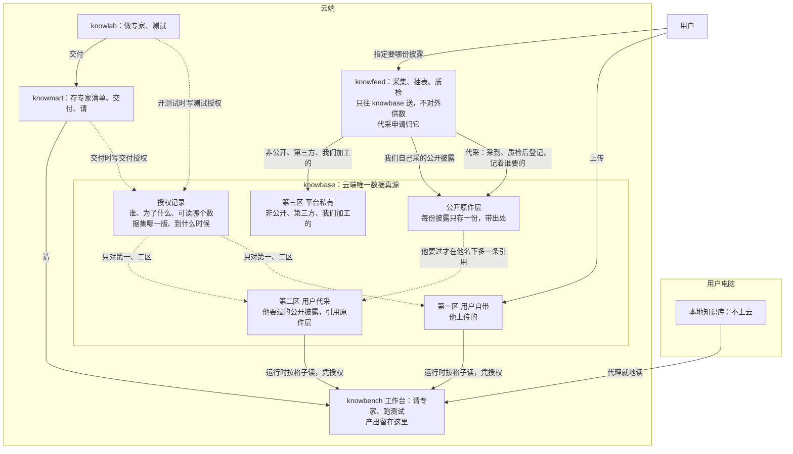

# 数据拓扑：knowbase 是云端唯一的数据真源

> Opus 2026-10-18 重写，底稿是远程 Fable 当天的初稿，依据所有者当天与 Opus、与 Fable 的讨论。
>
> **本页只定架构**：数据放在哪、归谁、谁能读、怎么进来、合规上怎么说。不谈实现和顺序，那些等架构定了再谈。还没进决定记录、没改 SDD、没动代码。
>
> 相关：[`拓扑.md`](拓扑.md)（网络拓扑）、[`constraints.md`](dev-investment-agent/tree-build/rules/constraints.md)（C-D 数据规矩、C-L 合规边界）、SDD 0026（knowlab）、0027 §3.5（契约 `knowbot-data/v1`）、0032（knowmart 专家目录）；决定记录 2026-10-16「数据来自用户上传的数据」、2026-10-18「请专家时数据 = 专家自带的 + 请的人自己的」。

## 一、为什么改

现在数据有两个真源：
- knowbase：knowfeed 采来的；
- knowlab「我的数据」：用户上传的，存在 knowlab 自己的存储里。

这违反我们自己的规矩：主档只有一份，别处只存引用和版本（C-D1、C-D14）。

10-16 定「数据来自用户上传的数据」，是为了合规：平台不给用户投资数据。所有者 10-18 的判断是，守住这条不必靠「必须上传」，靠「数据是谁选的」就够：**平台不提供数据，只按用户的指定取回公开披露。** 用户省掉下载再上传这一步，真源也回到一处。

## 二、先把四样东西分开

讨论里「知识库」一个词指了四样东西：

| 东西 | 是什么 | 在哪 |
| --- | --- | --- |
| 本地知识库 | 用户电脑上的一个目录，本地代理就地读 | 用户电脑，永远不上云 |
| 数据 | 表、财报、用户上传的文件 | **只在 knowbase** |
| 产出 | 专家交回的底稿、结果 | 留在工作台。它是结果，不是来源；用户想拿它当数据再用，就上传进 knowbase |
| 专家清单 | 方法、规则、引用了哪些数据 | knowlab 做、knowmart 存；只存「数据集 + 版本」的引用，不存数据 |

knowbase 是我们的系统；里面分区，前两区的数据归用户。

本页说的「用户」，以及所有者、授权里的用户，都是 Casdoor 组织 sunmoonai 里的同一个主体：一个人在 knowlab、knowbench、knowmart 里是同一人，三个应用共用。分组织、实名认证是以后的事（10-18 定）。

## 三、拓扑图

实线是数据流向，虚线是授权与引用。



## 四、knowbase：一层原件，三个区

公开披露的原件只存一份：按「渠道 + 发行人 + 报告 + 期间 + 版本」认。三区管的是**谁看得见、谁能读**，不管东西存在哪。

| | 第一区 用户自带 | 第二区 用户代采 | 第三区 平台私有 |
| --- | --- | --- | --- |
| 从哪来 | 用户从 knowlab 或工作台上传 | 用户指定，knowfeed 从白名单里的法定披露渠道（交易所、巨潮）取回；原件已经有了就直接给他一条引用 | 我们自己的：非公开来源、第三方整理的数、质检对照用的、运营研究用的 |
| 归谁 | 这个用户 | 这个用户（原件是公开的，「他要了这一份」这条事实归他） | 平台 |
| 谁能读 | 他本人，或有有效授权的 | 同左 | 只有管理端和内部工具 |
| 能不能授权 | 能 | 能 | **一律不能**，knowbase 收到就拒 |
| 别人看得见吗 | 看不见 | 看不见：没有目录、不能浏览、不能搜「谁要过什么」 | 用户不知道有这一区 |
| 删 | 他可删；有有效授权指着的版本默认不能删，他坚持删，就先把指着它的专家版本下架，授权随之失效，再删 | 同左（删的是他的引用，原件不动） | 运营管 |

第三区真正专属的只剩非公开、第三方、我们加工的东西。公开原件即使是我们自己的采集任务采来的，用户也只能经自己的代采引用拿到。原件打通了，第三区的硬隔离还在。

## 五、谁能读：knowbase 只认授权记录

读数据有好几种情况：作者自己读；作者的草稿在测试；已交付的专家那一版在运行；以后（10-18 三期）请专家的人读作者自带的数据。草稿、交付、请专家是 knowlab、knowmart 的概念，knowbase 不去理解它们。

**规则**：区对（第一、二区），并且下面两种之一，否则当这份数据不存在：

- **本人**：请求里带着用户本人的登录凭据（他在 knowlab 或工作台页面上看、管自己的数据，应用只是把他的凭据转交过来）。光有服务身份加一个用户名，不算本人。**这条机制现在没有，是新加的**：眼下应用之间只走服务身份，没有哪个应用会把用户的登录令牌转给另一个应用；要 knowbase 能验用户令牌，令牌的受众要包含 knowbase。
- **凭授权**：任何应用凭自己的服务身份替他读（测试、专家运行、请专家），一律要有一条有效的授权记录。授权里写明谁来读（哪个应用、哪次测试或哪次委托的编号），读的时候对得上才给。

调用方另核一遍，和现在 `knowbot-data/v1` 的做法一样。

**授权记录的种类**

| 种类 | 谁写 | 谁来读 | 可读什么 | 到什么时候失效 |
| --- | --- | --- | --- | --- |
| 测试 | knowlab，开测试前写 | 工作台，这次测试的编号 | 这次测试的草稿绑定的那几版 | 测试结束就撤；兜底：那次测试的时限加等人的最长时间 |
| 交付 | knowmart，交付时写 | 工作台，请这一版的委托 | 这一版专家绑定的那几版，包括作者代采的 | 跟着这一版专家，停用或下架就撤 |
| 请专家（三期） | knowmart，有人请时写 | 工作台，这次委托的编号 | 他请的那一版绑定的那几版 | 这次委托结束 |

**守则**
1. **授权人必须是数据的所有者**：knowbase 收到授权，核「数据的所有者」和「授权里的用户」是同一人，不是只认写来的那个应用。否则 knowlab 出一个 bug，就能把甲的数据授权给乙。
2. **哪个应用只能写哪种**：knowlab 只能写测试授权，knowmart 只能写交付、请专家授权，越种类就拒。
3. **授权给别人要有作者的同意**：现在一期只给所有者自己用（他的测试、他自己请他的专家）。到三期被授权的人不是所有者时，还要核作者有「公开时同意请的人看到被用到的数」那条记录（10-18 守线），没有就拒。
4. **第三区一律不接受授权**：这是结构上的规矩，不是靠没人去写。
5. **能撤，也有兜底的上限时间**：撤销消息丢了，到点也自动失效。
6. **写不上就不开跑**：测试、请专家拿不到授权就不开始，宁可停也不放。
7. **被引用的版本默认不能删**：有有效授权指着就不能删，这是一条查询，不是一个标记位。用户坚持删，先把指着它的专家版本下架，授权随之失效，再删（10-18 定）。
8. **每次读都留痕**：记谁读、凭哪条授权、读了哪个数据集哪一版。按调用记，不按格子记；只记编号，不记数值；保留多久照 C-R19 由所有者批。这是「用户选、平台跑腿」的另一半证据：不但能证明他要过，还能证明每一次读他的数据都有凭据。

专家绑了作者代采的那几版，以后别人请这位专家时，也照第 3 种授权读**作者绑的那几版**，不改读请的人自己名下的。否则同一位专家换个人请，读到的数据版本就不一样，测试结果没法复现，交付时的验收就白做了。

## 六、代采申请：用户指定，平台跑腿

9 月 29 日建的「申请入库」就是这条路，现在要接到第二区上，并且把「谁要的」一起留下。

```text
用户在 knowlab「选数据」或工作台里指定：茅台 2023 年报
        │
        ▼
原件层已有这一份？ ──是──▶ 在他名下记一条引用（第二区），完事
        │否
        ▼
knowfeed 建采集任务（来源在白名单里就自动受理，不在就等运营）
        │ 采、抽表、质检
        ▼
knowbase 登记进原件层（带出处、质检结果、谁要的），他名下记一条引用
```

「原件层已有这一份」只说明这份公开文件我们取回过，不能带出任何别的用户要过的痕迹：命中与否给用户看的内容一样（都是「拿到了」），也不显示「别人要过」。命中秒到、没命中要排队，快慢看得出平台取过这份公开文件，但分不出是哪个用户要的还是我们自己采的，「没有目录」照样守得住。用户挑公司、报告、期间时，选项来自披露渠道的公开索引，不来自我们库里有什么。这样「没有目录」守得住。

代采申请是一件有自己生命周期的事，归 knowfeed：要了 → 排队 → 采到 → 质检 → 进了他名下，全程留痕。合规证据就在这条记录里。

| 守什么 | 为什么 |
| --- | --- |
| 来源白名单：只收法定披露渠道的原件 | Wind、东财这类整理过的数，授权链不干净 |
| 只能由用户发起，运营不能替他加 | 选什么是用户定的，平台只是跑腿 |
| 配额和排队：命中已有的不计数 | 采集要算力，也会打上游网站 |
| 质检结果给用户看 | 抽表还不稳（茅台 2021 年口径那关没过），哪几项没对上照实标，用户自己判断 |
| 入口不另开网站 | 放在 knowlab 选数据页和工作台里，knowfeed 只出接口 |

## 七、knowbase 的职责与地位

- **职责**：从「平台数据的加工入库加检索」变成「**所有数据的主档**：存储、版本、所有者、授权、读取」。检索和索引是从主档派生出来的（C-D5）。
- **派生坏了不挡主档**：检索出问题时，不影响主档的存取，也不挡专家读数（C-D15）。
- **一级服务**：每次测试、每次请专家都要经过它，它是关键路径。冷建时备份和恢复排在别的应用前面；上线门那条（备份能恢复、做过一次恢复演练，C-R10）先过它。

## 八、抽表是加工：每个数都能追回原件的哪一页

取回原件是跑腿；从 PDF 里抽出数字是平台在加工，抽错了就是平台带进来的错。而且原件和抽出来的表都会被多个用户复用，所以每个数都要能追回原件的哪一页，质检没对上的照实标出来。这不是锦上添花，而是复用说得过去的前提。它同时满足我们的数据规矩（原始证据先存、带出处，C-D13）和《金融信息服务管理规定》里「来源可追溯」那一条。

## 九、合规上怎么说

| 环节 | 谁做 | 平台的角色 |
| --- | --- | --- |
| 选哪家公司、哪份报告 | 用户 | 不选、不推荐、不预置清单、不给别人看目录 |
| 取回公开披露原件 | 平台 | 跑腿 |
| 整理成表 | 平台 | 加工：不改数、每个数带出处到页、质检结果照实写 |
| 怎么算、怎么判断 | 用户的专家（方法来自用户） | 只提供计算工具 |
| 结果给谁 | 用户自己 | 不给别人、不拿去宣传 |

- **C-L2 改写**：「平台不提供数据，只按用户指定取回公开披露；用户的专家只读它有权读的第一、二区数据（所有者本人的，或凭授权的），第三区不可达」，取代 10-16「数据来自用户上传的数据」那半句。
- **第三区硬隔离查得出来**：授权接口拒第三区，运行时的服务身份到不了第三区。「平台没给用户数据」不靠自觉。
- **我们自己也不抄近路**：孵化「财务分析与预测」时，只能以普通用户账号走第一、二区。
- **《金融信息服务管理规定》**（网信办，2019-02-01 施行）：我们可能算「金融信息服务提供者」。按条文摘要，这不是发牌照，而是要配审核人员、内容审核和信息安全制度、来源可追溯，不得传播虚假金融信息。
- **律师那批问题**（0026「五、合规分析」）改写、补充：
  1. 「用户指定公开披露文件、平台代为取回并整理成表，方法来自用户、结果只给用户自己」，这个形态算不算证券投资咨询或「荐股软件」？
  2. 我们算不算金融信息服务提供者，要配哪些制度？
  3. 「荐股软件」规定里，有没有「只做信息汇总、历史数据统计的软件不算」这一说（Opus 查过，没找到原文，不敢断定）。
- **答复回来之前**：第二区只收法定披露渠道的原件，不收行情、第三方整理的数、评级、一致预期。

## 十、不变的

- 本地知识库永远不上云。
- 工作台的产出留在工作台。
- 专家清单只放引用。
- 用户的方法只来自用户（C-L1）；专家只归用户自己，直到三期拿到资格、问过律师。

## 十一、这一版定下的

所有者 10-18 定**甲**：knowbase 是我们的系统，是云端唯一的数据真源，里面分三区，前两区的数据归用户。下面各条是 Opus、Fable 的一致意见，按所有者「你重写一版」写入本页，所有者看过后进决定记录：

1. knowbase 分用户自带、用户代采、平台私有三区；前两区按用户隔离，第三区用户的专家不可达。
2. 公开原件只存一份，三区是视图；用户要的原件已经有了，就直接给他一条引用。
3. knowbase 只认自己存的授权记录（谁、为什么、可读哪一版、到什么时候），由业务方写进来；它不去理解草稿、交付、请专家这些概念。
4. 授权的守则：授权人必须是所有者；哪个应用只能写哪种；授权给别人要有作者的同意；第三区一律不接受授权；能撤、有兜底的上限时间；写不上就不开跑；被引用的版本不能删；每次读都留痕。
5. 专家绑了作者代采的数据，别人请时读作者绑的那几版（交付授权、请专家授权），不改读请的人自己的。
6. 代采申请归 knowfeed，有自己的生命周期，结果连「谁要的」一起登记。
7. knowbase 的主档和检索分开，检索坏了不挡读数；按一级服务对待，备份和恢复排在前面。
8. 抽出来的每个数都能追回原件的哪一页。
9. C-L2 照第九节改写；律师问题照第九节改写、补充。
10. 「本人」只认请求里带着的用户本人的登录凭据；应用凭服务身份替用户读，一律凭授权，授权写明谁来读。

## 十二、第十一节之后又定的（所有者 2026-10-18「按你的建议」）

1. **工作台通向第三区的口要关**。不只是代码里内置版「财务分析与预测」用的检索口：现在**每个用户的沙箱默认都带一张 knowbase 的 MCP 令牌**（设置「云端与模型 → MCP」开关默认开，`provisioning.py` 发令牌），用户在聊天、工作模式里，模型都能直接查第三区的数。照新的 C-L2 这就是平台在给用户数据，现网就是这样。定：knowbase 从用户的 MCP 来源里拿掉，沙箱不再发这张令牌，开关去掉；内置版专家一起撤（待办账 111）。以后 knowbase 给用户开口，只开第一、二区，按「本人 / 凭授权」读。随下一次发布（qwen-007）做。
2. **搬家排在第一条实测（K21）之后**：先在 knowlab 现有存储上跑通测试链，再换存储，两件事不叠在一起。第一条实测的数据由 sig-am 上传一张小表（照决定单第 0 条收窄）；搬家时迁进第一区，专家重新绑定、出第二版。
3. **第二区第一版**：只开巨潮一个渠道的 A 股定期报告（年报、半年报、季报），只抽三张报表；**不限公司**，用户点哪家采哪家；每人每天有配额，命中已有的不计数；抽表没对上照实标，原件照样给。按来源自动受理（巨潮定期报告一律自动），**不按公司清单**：10-15 演示流程里「在关注清单里的公司自动批准」那一条和「不预置清单」冲突，改掉。
4. **读数留痕留一年**（只记编号、不记数值），律师答复后再调；测试记录照旧留 7 天。
5. **用户管自己数据的入口放工作台**：侧栏脚现成的两个位置，「知识库」放上传和列表，「信息采集」放代采申请（账 85）；knowlab 只负责挑数据、绑版本。

**顺序**：qwen-006 走查 → qwen-007（审读修复，加第 1 条）→ 决定单 13 条、sig-am 上传小表、第一条实测（K19–K21）→ 设计三区、授权、代采、用户令牌 → 搬家，「财务分析与预测」换成代采的完整财报、出第二版。

## 十三、还没定的

- 律师的答复（0026 第五节 9 问）。公开售卖、收费之前必须拿到；现在都是自用，不挡演示。

架构定了，再谈实现。
