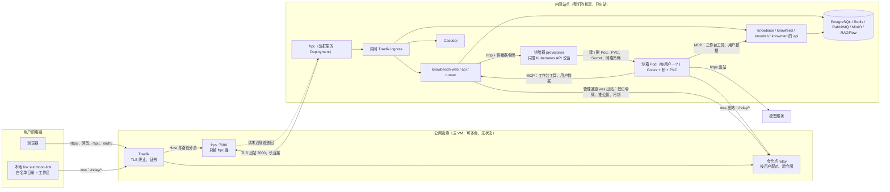
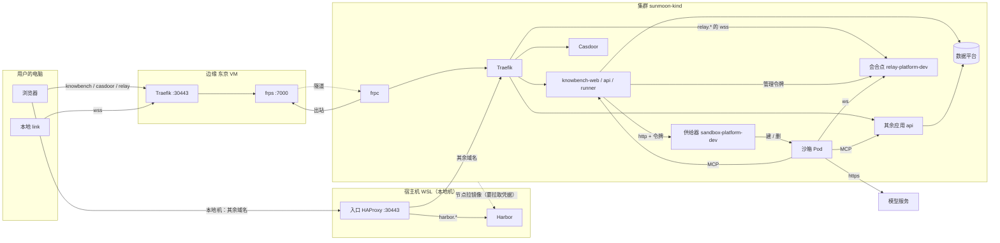

# 运行拓扑

两部分：**一、东西在哪、谁连谁**（用户、边缘、内网、本地 link、沙箱、会合点、供给器）；**二、版本怎么进集群**（从一次修改到集群按固定版本运行的路径）。

- 正式拓扑的裁定与风险：[`SDD/architecture/topology.md`](dev-investment-agent/tree-build/SDD/architecture/topology.md)；边缘：[`infrastructure/edge/README.md`](../infrastructure/edge/README.md)。端口和名字以各组件目录的 `config.yaml` 为准。
- 账号、电脑、本地 link、会合点的关系与叫法：[`账号-电脑-link-会合点.md`](账号-电脑-link-会合点.md)。
- 发布的故障处理与退回命令以 [Flux 手册](../infrastructure/flux/README.md) 为准；当前生效的声明摘要只记在 [flux-source.yaml](../infrastructure/environments/kind/flux-source.yaml)，本文不另抄。

# 一、东西在哪、谁连谁

## 1. 正式拓扑（所有者 2026-09-26 定：开发期这样，服务用户也这样）

三个地方，两条不变量：**深处只出站**（内网和用户电脑只发起连接，不接受连接），**边缘无状态**（边缘不存业务数据，任一台可替换）。



| 流量 | 走哪 | 为什么 |
| --- | --- | --- |
| 浏览器能到的一切 HTTP（网页、`/api/`、`/auth/`） | 边缘 Traefik → frps → 隧道 → 内网 frpc → 内网 ingress | 内网不开入站端口，HTTP 由内网主动连出来的长连接送回 |
| 本地 link、沙箱、工作台管理通道 | wss 到会合点 | 会合点要按用户验令牌、配对、核两端 Codex 版本 |
| `/mcp/` | 不对外，沙箱在内网直连 | 以后内网外有消费者再开 |
| 边缘公网端口 | 只开 HTTPS、80（签证书）、7000（frps）、SSH | 其余只绑 127.0.0.1 |

## 2. 现网（2026-10-20）

边缘已经上了：东京云 VM（`infrastructure/edge/config.yaml` 的 `edge_public_ip`）跑 `sunmoon-edge.service`（Traefik + frps，开机自启），HTTPS 口 30443，证书走 ACME；集群里的 frpc（`gitops/components/ingress-platform/frpc/`）出站连 frps。

| 域名 | 怎么到 |
| --- | --- |
| `knowbench`、`casdoor`、`relay`（`edge_domains`） | 公网：边缘 Traefik → frps → 隧道 → 集群 frpc → 集群 Traefik；casdoor 只放行登录要用的路径（`edge_path_allowlist`），其余 403 |
| 其余（knowlab、knowmart、knowbase、knowfeed、tpl、各管理端、harbor） | 只在本地机经宿主入口 HAProxy `:30443`（只看 SNI 分流、不解密）到集群 Traefik |

和正式拓扑的差别：**会合点仍在集群里**（`gitops/components/relay-platform/relay/`），本地 link 与沙箱经边缘、隧道连到它，不是边缘上直接跑；宿主入口 HAProxy 还在。协议和组件声明不变，改的是部署清单（`C-T9`）。



## 3. 各管什么

| 东西 | 在哪 | 管什么 | 不管什么 |
| --- | --- | --- | --- |
| 浏览器 | 用户电脑 | 登录、登记 key、拉沙箱、发话、看结果 | 不碰文件 |
| 本地 link | 用户电脑 | 让沙箱里的 Codex 读写白名单目录里的文件；上限（只读 / 只改白名单 / 不设限、联不联网）在它这边定 | 不跑模型、不存 key；不开端口，只连出去（本机回环口只给我们的工作台读） |
| 边缘 Traefik | 边缘 | 终止 TLS，按域名和路径分流 | 不存任何业务状态 |
| frps / frpc | 边缘 / 内网 | 把浏览器的 HTTP 请求沿内网连出来的长连接送回内网 | 不验用户、不配对 |
| 会合点 relay | 现网在集群（正式拓扑在边缘） | 把沙箱和本地 link 按用户配对；验令牌（公钥就地验）；给 runner 一个管理口；每 20 秒 ping 一次本地 link | 不存文件、不跑模型 |
| 供给器 provisioner | 内网集群 | 按 runner 的请求给用户建 / 删沙箱 Pod、PVC、Secret、网络策略；只认一个令牌，只会建这一种东西 | 不和本地 link 通信 |
| 沙箱 Pod | 内网集群，每用户一个 | 跑 Codex；模型 key、会话记录在它的 PVC 里；用工具走 MCP；调模型走出站 https | 碰不到别的用户、碰不到集群别的东西（网络策略） |
| knowbench-runner | 内网集群 | 工作台的推进器：连沙箱、按方法包一步步推、验收、算费用；专家测试也在这里推 | |
| 各应用 api | 内网集群 | 网页接口；knowbench 给沙箱提供 MCP 工具（工作台工具 `sunmoon-workbench`），专家读用户数据时由 knowbench 再问 knowlab（按测试或已交付的那一版核） | |

## 4. 一次「工作」的顺序

1. 浏览器打开工作台，Casdoor 登录；设置里登记模型 key（后端加密存库）。
2. 点「拉起沙箱」：runner 拿供给器令牌叫供给器建沙箱 Pod。
3. 给本地 link 颁发这个账号的令牌（托盘 → 浏览器确认页 → 「允许」）；本地 link 和沙箱里的桥都用 wss 连会合点，按用户配对。本地 link 里加的白名单目录就是工作区，项目是工作区下的子目录。
4. 用户在项目里发话：runner 经会合点的管理口把指令交给沙箱里的 Codex。Codex 要读写文件时经会合点转到本地 link，只能动白名单目录。
5. Codex 用工作台工具走 MCP 到 knowbench；专家读用户数据时 knowbench 再问 knowlab；调模型走出站 https。

## 5. 为什么要供给器，不让 knowbench 后端直接建 Pod

建 Pod 的权限给到应用后端，应用一旦被打穿就能在集群里随便建东西。把这个权限收在一个只认一个令牌、只会建沙箱 Pod 的小服务里，应用后端只能让它「给这个用户建一个」。代价是多一个组件。

## 名字对照

| 代码里 / 仓库名 | 文档和页面里的叫法 | 是什么 |
| --- | --- | --- |
| `sunmoon-link` 仓，包 `@sunmoon/agent` | 本地 link | 装在用户电脑上的程序 |
| `relay-platform/relay` | 会合点 | 平台组件：配对、验令牌、透传 |
| `sandbox-platform/sandbox` | 沙箱 | 每用户一个 Pod，里面跑 Codex |
| `sandbox-platform/provisioner` | 供给器 | 建、删沙箱 |
| `knowbench-app` | knowbench 应用 | 后端 + 网页端 + 管理端 |
| 后端进程 `api` | 网页接口 | 浏览器和 MCP 调的 HTTP 接口 |
| 后端进程 `worker` | 工作进程 | Celery 任务：采集、投递、评测这类后台活 |
| 后端进程 `scheduler` | 定时器 | Celery beat，按时触发任务 |
| knowbench 后端进程 `runner`（Pod `knowbench-runner`；将改名 `manager`，账 53） | 推进器 | 连沙箱、下指令、收事件、验收、算费用、管项目和专家流程 |

# 二、版本怎么进集群

本地 KIND 与以后的云集群走同一条路径。变的是环境参数，发布步骤相同。

## 1. 文件分成输入和声明

输入由人维护。声明由渲染生成，位于 `gitops/`，Flux 按它维持集群。手改声明会在下次暂存时被重写。`infrastructure/` 里的 Make 与 Ansible 是渲染和发布程序，Flux 不读取；发布打包的也只是 `gitops/`。

| 输入 | 位置 | 内容 |
|---|---|---|
| 业务源码 | 应用仓库；k8s 仓用 [sources.yaml](../infrastructure/applications/sources.yaml) 固定修订 | 程序行为。它先变成镜像，再由镜像摘要进入声明 |
| 组件参数 | `gitops/components/<对象>/config.yaml` | 开关、用户名、端口、资源、代次。真实口令不写在这里 |
| 环境身份 | [site.yaml](../infrastructure/environments/kind/site.yaml) | 集群名、仓库地址、各平台命名空间 |
| 模板 | 组件目录 `*.yaml.j2` | 把参数填成 Service、Deployment、Ingress 等 |
| 准备任务 | 组件目录 `prepare.yaml` | 填模板之前在本机执行：校验、口令与 TLS、模板要用的计算值 |
| 阶段清单 | 组件目录 `stage.yaml` | 本组件有哪些阶段、依赖谁、用哪份准备任务、生成哪些文件 |
| 镜像锁 | 组件 `image.lock.*`，官方镜像在物料锁 | 要运行的镜像摘要 |
| 私有输入 | 本机 `services_config_dir`，不进 Git | 口令、令牌、私钥的主份与备份 |

声明是已提交的这些 YAML：工作负载、Service、IngressRoute、每个阶段目录的 `kustomization.yaml`、SOPS 密文 Secret，以及阶段图 `gitops/clusters/kind/stages.yaml`。

以 relay 为例。`config.yaml` 写 `relay_port: 47100`，模板写 `port: {{ relay_port }}`。阶段清单写阶段名 `relay`、依赖 `traefik`、准备任务 `prepare.yaml`、资源 `workload.yaml` 和两份密文。渲染之后才有 `workload.yaml`。改端口改 config，再渲染、暂存。六个应用（tpl、knowfeed、knowbase、knowbench、knowlab、knowmart）各自有 config 和阶段清单，共用 `app-platform/common` 的准备任务。

## 2. 阶段

阶段清单里的每一项，会变成阶段图里的一条指令。这条指令的 kind 是 `Kustomization`，apiVersion 是 `kustomize.toolkit.fluxcd.io/v1`，放在 `flux-system`。它是 Flux 控制器的自定义资源，称为 Flux Kustomization。它不是 Pod，也不描述容器。

一条指令写明：

- `sourceRef`：拉哪一个已晋级的 OCI 包
- `path`：包内哪一个目录
- `dependsOn`：哪些阶段 Ready 之后才开始
- `interval`：多久重新核对一次
- `healthChecks`：这个目录怎样算就绪
- `prune: false` 与 `deletionPolicy: Orphan`：指令不再提到的对象留在集群里

控制器拉包，用该目录的 `kustomization.yaml` 把清单拼成具体对象，应用到集群，并按健康检查等待。到点再核对一次，把漂移改回声明。所以受 Flux 管的部署不要 `kubectl rollout restart`（对账时会被改回去），重启就删 Pod。

组件目录里的 `kustomization.yaml` 是另一份文件：Kustomize 的资源清单，列出本目录有哪些 YAML。Flux Kustomization 决定何时、对哪个目录使用那份清单。阶段图中每条指令的 `path` 指向一个含这份清单的目录。

一个组件可以有多个阶段。Casdoor 的建库阶段指向 `database` 目录，依赖 `postgresql`；初始化阶段再依赖建库阶段。依赖未 Ready 时，后一阶段不开始。阶段清单里 `enabled` 为假时，这次渲染不产生该指令；已经在跑的对象不会因此停止。

阶段清单还给本机渲染器两件集群指令里没有的信息：`prepare` 指向准备任务；`resources` 以及有的阶段上的 `render` 列表指出要生成哪些文件。阶段图由 [stages.py](../infrastructure/components/stages.py) 扫描全部阶段清单得到。

后文的 Make 目标 `stage` 与「阶段」同字，含义不同。阶段是集群里的这条指令。`stage` 是把渲染结果写入 `gitops` 工作区，下文称为暂存。

## 3. 两种摘要

镜像摘要标识 Harbor 里的一个容器镜像。工作负载写成 `仓库/项目/名字@sha256:…`。节点按这个摘要拉取。

声明摘要标识 Harbor 里的一整包 `gitops`。发布时从某次 Git 提交导出并推成 OCI，得到另一个 `sha256`。集群里的 Flux 拉的是这个包；包内的工作负载再按镜像摘要拉容器。

Git 修订是导出该包的那次提交，40 位哈希。它与声明摘要来自同一次发布。晋级时保留这次修订。写入源指针的那次新提交只含指针文件，不用它替换修订。

## 4. 从修改到集群

```text
（自研镜像）构建 → 渲染 → 暂存 → 提交 → 发布 → 晋级 → 部署 → 检查
```

官方镜像和宿主模块没有业务源码构建，从物料锁进入渲染。六个应用，以及要重建的 relay、sandbox，先构建镜像。

链上有两份候选，都是「已经生成、尚未成为集群正在使用的版本」。

**声明候选**是渲染写出的 YAML，目录在 `infrastructure/.build/components/`。内容是工作负载、密文 Secret、阶段目录的 `kustomization.yaml`，以及用 `topology-render` 时的阶段图。它供人审阅。暂存才把同一份文件拷进 `gitops/`。只留在 `.build/` 里的候选不会被发布，因为发布器只打包已提交的 `gitops/`。

**发布候选**是发布之后的 `infrastructure/.build/flux/source-candidate.yaml`。它记下 Harbor 里新 OCI 包的仓库、声明摘要、Git 修订、路径和是否要 SOPS。晋级才把这五个字段写进 `flux-source.yaml`。发布候选不改变集群正在拉的包。

### 构建镜像并写入 image.lock

自研镜像先构建、推到 Harbor，再把得到的镜像摘要写进组件目录的 `image.lock`。这是镜像进入声明之前的交接，还不是声明摘要。

应用构建从 `sources.yaml` 锁定的 Git 对象导出配方，打出 `linux/amd64` 镜像并推到 Harbor。发布方核对清单摘要。组件下的 `image.lock` 记下仓库名、成品摘要、源码修订和部署代次，例如 `tpl-backend/image.lock.yaml` 里的 `digest`。官方镜像不走这次构建，摘要来自物料锁。

**构建核对提交号**（`infrastructure/applications/build.yaml`）：每个组件实际检出的提交（父仓 `parent_revision` 里记的 gitlink）必须和 `sources.yaml` 钉的 `*_revision` 是同一个号，比的是号不是代码内容。所以父仓钉到新提交时，它记的每个子仓提交都要同时钉上——哪怕某个子仓代码没变、只是提交号变了，也要换钉、重建一次。

`image.lock` 留在 `gitops/` 里，和 config 一样供下次渲染读取。模板把它写成工作负载里的 `名字@sha256:…`。此时 Harbor 里多了一个镜像，集群仍按旧声明包运行，直到这次锁进入新的声明包并被晋级、部署。

### 渲染

平台组件和应用共用 [render.yaml](../infrastructure/components/render.yaml)。日常按对象选择：`OBJECT=data-platform/postgresql`、`OBJECT=app-platform/tpl-app` 或 `OBJECT=all`。渲染时 `components_action=render`。`application-render APP=tpl` 只是把对象设成 `app-platform/tpl-app` 再调用同一剧本，不是第二条渲染链。

内部顺序是：按 `OBJECT` 选出阶段；核对本机集群身份；运行选中对象的 `prepare.yaml`；把模板写到 `infrastructure/.build/components/<对象>/`；为保留卷生成 `storage.yaml`，并写出该阶段的 `kustomization.yaml`。

准备任务在填模板之前运行。它读取 config、镜像锁和已有私有输入，不合格则停止；没有口令或令牌时生成并备份，已有的不覆盖；签发 TLS；把这些材料加密成 `*.sops.yaml`；算出模板要用的值，例如 rollout 的输入摘要。有的准备任务自己把模板写进候选目录，通用渲染器再渲染阶段清单 `render` 列表里的模板。knowbase 的 provider 准备任务可能访问远端 RAGFlow。这些是本机副作用，不是向集群 apply。

渲染不修改 `gitops/`，也不修改阶段图。要看阶段图候选，用 `topology-render`，结果在 `.build/components/cluster-stages.yaml`。

### 暂存

日常入口是 `platform-stage OBJECT=...`，平台组件和应用都走这一条。它内部只调用一次组件暂存。Make 目标仍叫 `services-stage`，这是旧文件名留下的实现入口，剧本已经是 `components/render.yaml`。`application-stage APP=tpl` 同样只是换成 `OBJECT=app-platform/tpl-app`。

暂存使用这份剧本，`components_action=stage`。它先把准备和渲染再做一遍，候选仍写入 `.build/components/`，再拷贝到 `gitops/components/<对象>/`。随后 `topology-stage` 把阶段图写回 `gitops/clusters/kind/stages.yaml`。选中单个对象时，未被选中的阶段须与已提交内容相同。`OBJECT=all` 重写整份阶段图，其中包含应用阶段，不会按应用再暂存一遍。

分成两次命令时，先渲染再暂存。只执行暂存也可以，因为它内部先渲染。暂存之后再渲染，只会刷新 `.build/`，不会改掉已经拷进 `gitops/` 的文件。

渲染和暂存都会创建私有目录、证书和身份备份，并为选中的保留卷准备节点上的空目录。已有数据目录不递归改权限。ELK 的准备任务还会设置宿主 sysctl。

暂存之后，工作区里有了新声明，尚未提交，集群仍运行旧的已晋级包。只渲染不暂存时，发布器看不到这次修改。只改 config 或模板而不暂存时，`gitops/` 里仍是上次生成的 YAML。

### 提交

审阅 `.build/` 或暂存后的 `gitops/`：公开对象的结构，以及 Secret 是否为 SOPS 密文。然后本地提交。发布器要求 `gitops/` 工作区干净。本仓库不自动 push。

组件 README 可以单独修改，不参与「工作区是否等于已晋级 Git 对象」的字节比较。配置、模板、锁、密文和运行声明仍须一致。

### 发布

`make -C infrastructure flux-release` 依次做这些事：

1. 读取 `HEAD`，确认 `gitops/` 干净。
2. `git archive HEAD:gitops`，只打包这次提交里的声明。
3. 对 `clusters/kind` 和每个含 `kustomization.yaml` 的目录做 kustomize，确认能构建。
4. 拒绝明文 Secret。Secret 须带 SOPS age、加密范围和 MAC。
5. 用 `flux push artifact` 推到 `oci://harbor.sunmoonai.com:30443/platform/deployments-kind`，标签名为 `git-<提交号>`。
6. 把 `repository`、声明摘要 `digest`、Git 修订 `revision`、包内入口 `path`（`./clusters/kind`）、`requires_sops` 写入 `infrastructure/.build/flux/source-candidate.yaml`。

标签是这次推送的名字。以后引用声明摘要。发布不修改 `flux-source.yaml`，现网仍拉旧包。

### 晋级

把发布候选的这五个字段写入 `flux-source.yaml`，再本地提交。这里的候选是 `source-candidate.yaml`，不是 `.build/components/` 里的声明候选。`requires_sops` 为 true 时，集群须用 SOPS 解密包内 Secret，不能靠关闭开关绕过。

晋级不执行 apply。此前 `platform-deploy` 会拒绝，因为工作区 `gitops/` 与正在生效的源不一致。`platform-check` 仍可检查现网。

### 部署

`flux-source-apply` 把已晋级指针应用到集群里的 Flux 源，并等待该代次 Ready。源 Ready 表示包已经拉到，不表示其中的 Job、Pod 和业务已经通过。

`platform-deploy` 先核对工作区与已晋级 Git 对象一致，再执行 source-apply，然后做模块检查。它不部署工作区里尚未发布的修改。整套声明是一个 OCI 包。组件级 deploy 只调和选中对象；依赖阶段须已启用且 Ready。

### 检查

`platform-check` 与组件 verify 做协议检查：数据库登录、镜像摘要、阶段 Ready、应用 API。公共入口检查走宿主 30443。浏览器点击和全部业务功能不在此列。

## 5. 包进入集群之后

Flux 读取阶段图，按 `dependsOn` 调和各目录，把漂移改回声明。`prune: false` 与 `deletionPolicy: Orphan` 使从声明中去掉的对象留在集群里。退回旧声明也不会卸掉新加的对象。退役要另定范围，按 UID 处理。

数据库 schema、初始化账号和持久卷不随 Git 退回。退回声明之后，数据要另做与该版本匹配的恢复。维护前保存原 `flux-source.yaml`。

## 6. 冷建新集群

目标是冷建 `sunmoonai-kind`，现网 `sunmoon-kind` 继续运行它已经晋级的版本（平台线 D，见 SDD 0033）。

渲染、暂存和本地提交可以在冷建前完成。发布和晋级在冷建前做一次。环境参数化还会改声明，更早的 OCI 会被下一次发布覆盖。发布只把 OCI 写入宿主 Harbor，晋级只改源指针。不对现网执行 `flux-source-apply` 或 `platform-deploy`。

新集群的 Flux 从已晋级的声明摘要拉包。首次初始化读取密码表导入的预设。镜像须已在 Harbor。入口切换和退役另批。

## 7. 上云

上云走同一顺序，使用同一声明摘要、同一批镜像摘要、同一套阶段依赖。更换的是环境参数：集群名、仓库地址、入口、存储类、节点选择。这些值目前写在本机 KIND 上。环境参数化完成之前，现有 OCI 不能直接当作云上生产源。

云上的仓库可以仍在集群外。变的是 `flux-source.yaml` 的 `repository` 和镜像引用里的地址，发布步骤不变。

## 相关

- 会合点协议：`SDD/modules/0004-relay.md`；沙箱、供给器、会合点的声明：`gitops/components/sandbox-platform/`、`gitops/components/relay-platform/`
- 源码：`infrastructure/applications/component-images/sandbox-platform/`、`infrastructure/applications/component-images/relay/`；本地 link 在 `sunmoon-link` 仓
- 边缘：`SDD/modules/0013-edge.md`、`infrastructure/edge/`；宿主入口分流与域名：`infrastructure/entry/README.md`
- 做到哪一步：[CHECKPOINT.md](../CHECKPOINT.md)
